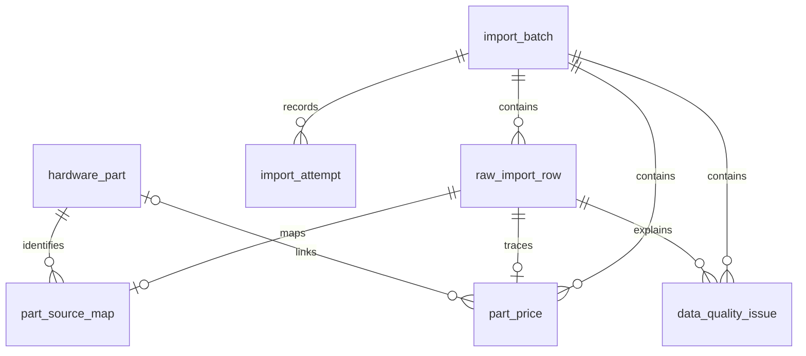

# BuildPilot AI — 完整项目实施手册（M08 Agent 补充修订版）

2026-10-16：M00–M08 已实施（M06/M07/M08 Agent 为 Mock）；真实模型与 M09–M12 尚未实施，真实规格覆盖缺口仍保留。


---

<!-- 源文件：README.md -->

# BuildPilot AI — 电脑 DIY 智能装机 Agent（M08 Mock 兼容工具已接入）

> 实施前必须同时阅读 [docs/11_PLAN_REVISION.md](docs/11_PLAN_REVISION.md)。该文件定义本次修订的业务规则、验收与执行顺序；冲突处以修订条款为准。M00–M07（M06/M07 为 Mock）、M08 规则、工作台与 Mock Agent 只读接入已实现；验收结果见 docs/verification/。

> **当前已实现 M00 工程基座、M01 文件清洗和 M02 数据库迁移/入库。** M03 配件 API/查询界面已实现，真实 CPU/GPU 样例已批准并通过验收；M04 手动装机已实现并验收，M05 登录和租户隔离已实现，M06 Mock 只读目录助手及 M07 持久化会话已实现；尚未接真实模型。按修订后的阶段顺序逐关验收。

## 本地运行（M00）

需要 Node 22（本机验收 22.23.1 / npm 10.9.8）、uv 0.12.5，以及运行中的 Docker Compose v2。Python 固定为 3.12.12，由 uv 选择/安装；PostgreSQL 17.6-alpine 已固定镜像摘要。React 19.3.0、Vite 8.3.4、Ant Design 6.6.6、FastAPI 0.143.0；完整依赖见 backend/uv.lock 和 frontend/package-lock.json。

在项目根目录执行：

```bash
make setup   # 创建私有 .env；保留已有配置；安装锁定依赖
make db-up   # 启动 PostgreSQL，等待健康状态
make dev     # 同时启动前后端；Ctrl+C 停止两者
```

已有依赖与配置时，一次启动可用 `make db-up && make dev`。首次安装需要访问包源；M00 运行无需 LLM Key。

- 页面：http://127.0.0.1:5173/
- 存活：http://127.0.0.1:8000/health（不依赖数据库）
- 就绪：http://127.0.0.1:8000/ready（真实 SELECT 1；失败返回 503）
- OpenAPI：http://127.0.0.1:8000/docs
- 数据库：127.0.0.1:5433；密码只在本地 .env，脚本随机生成且不显示。

前端通过 Vite 同源代理访问 /health、/ready、/api，不需要开放跨域。只绑定loopback，M05装机工作台需要登录；原Demo方案保留原归属。公共目录仍可匿名浏览。

### 测试与检查

```bash
make check                   # Ruff、pytest、Oxlint、TypeScript、Vitest、前端 build
python3 scripts/smoke.py      # 真实 HTTP + 数据库验收；先运行 make db-up
```

单独调试：

```bash
cd backend
UV_CACHE_DIR=/tmp/buildpilot-uv-cache uv run --locked uvicorn app.main:app --reload --host 127.0.0.1 --port 8000
# 另一个终端
cd frontend
npm run dev
```

GitHub Actions 已执行并通过前后端质量检查和真实数据库 smoke：[M00 基线 CI](https://github.com/MaTouNB/BuildPilotAI/actions/runs/38364422647)（提交 32d98f8）。CI 不依赖原始第三方 ZIP。

### 停止、清理与故障定位

- `make dev` 的终端按 Ctrl+C 停止前后端；`make db-down` 停止容器，保留数据库卷。
- 重建本地依赖可以移除 backend/.venv、frontend/node_modules 和 frontend/dist，然后重跑 make setup；不需要删除原始数据。
- 数据库卷 buildpilot_postgres_data 是持久数据。普通停止命令不会删除它；不要把删除卷当作日常清理步骤。
- API 未连接：确认 8000 端口服务已启动。数据库未就绪：确认 Docker 在运行、容器 healthy、.env 已配置，且 POSTGRES_PORT 与映射一致。
- 已有数据库卷时修改 .env 密码不会自动修改数据库账户密码，应恢复原凭据或进行明确的数据库凭据变更。
- 5173/8000 被占用时先停止冲突进程；开发端口固定，不静默切换。
- `npm run preview` 仅预览静态构建，不包含开发代理；完整容器部署在 M12 实施。

实现说明及真实结果：[M00 验收记录](docs/verification/M00.md)。学习讲解及三个练习：[M00 学习笔记](docs/learning-notes/M00.md)。

实现时参考：[Vite 入门](https://vite.dev/guide/)、[FastAPI 最小应用](https://fastapi.tiangolo.com/tutorial/first-steps/)、[uv 项目管理](https://docs.astral.sh/uv/guides/projects/)。

## M01 数据审计与文件清洗

M01 不导入数据库，不调用模型，新增代码仅使用 Python 标准库。当前默认页面为 M03 目录，环境状态可切换查看。

在项目根目录运行全量验收：

```bash
python3 scripts/check_m01.py
```

该脚本校验输入哈希、核对全部 25 类基线、检查每条源行都有去向，并验证重复导出的文件逐字节一致。原始 ZIP 必须在本地；公开仓库和 CI 不包含该文件。

也可在 backend 目录分步执行：

```bash
UV_CACHE_DIR=/tmp/buildpilot-uv-cache uv run --locked python -m app.etl.profile --input ../data/raw/csv.zip --output ../data/processed/m01-profile.json
UV_CACHE_DIR=/tmp/buildpilot-uv-cache uv run --locked python -m app.etl.clean --input ../data/raw/csv.zip --output ../data/processed/m01-dry-run --dry-run
UV_CACHE_DIR=/tmp/buildpilot-uv-cache uv run --locked python -m app.etl.clean --input ../data/raw/csv.zip --output ../data/processed/m01
```

- dry-run 只输出 profile、quality_report 和归属标记；不写 JSONL、不连接数据库。必须使用独立报告目录，不能覆盖已有完整清洗输出。
- 完整清洗输出 raw.jsonl、八类 cleaned 文件、extensions.jsonl、quarantine.jsonl 和报告；全部保留在被 Git 忽略的 data/processed/。
- 源行不合并，candidate_key 只表示疑似同规格候选，不是稳定 SKU。is_quotable 一律 false，待 M02 建立目录身份和选价规则后才能报价。
- ROUND_HALF_UP 将价格明确舍入到两位小数，原价保留在 raw_data，并记录舍入警告。价格缺失保持 null；冲突不选最低价或均价。
- 所有现有源字段都保留；不擅自推断 CPU socket、主板 DDR 类型、机箱限长或不确定的频率单位。
- 重跑只替换本工具拥有且无外来文件的输出目录。不要同时向同一目录运行多个清洗进程。

实际结果与限制：[M01 验收记录](docs/verification/M01.md)。讲解与练习：[M01 学习笔记](docs/learning-notes/M01.md)。

## M02 PostgreSQL 入库

SQLAlchemy 2.1.4 / Alembic 1.20.0 已锁定。迁移先建六张业务表及 import_attempt 审计表；未审核记录保留在 raw_import_row.normalized_data 和 part_price staging，part_id 为 null，不自动创建规范 SKU。

```bash
make setup
make db-up
make db-migrate
make check        # 非数据库测试、静态检查、前端测试及构建
make check-db     # 真正 PostgreSQL 测试；随机隔离 schema，不清空业务表
make check-m02    # 本地全量入库、重跑和溯源验收；需已有 M01 输出及原始 ZIP
```

在 backend 目录分步验证/应用：

```bash
UV_CACHE_DIR=/tmp/buildpilot-uv-cache uv run --locked python -m app.etl.import_db --input ../data/processed/m01 --dry-run
UV_CACHE_DIR=/tmp/buildpilot-uv-cache uv run --locked python -m app.etl.import_db --input ../data/processed/m01 --apply
```

`--dry-run` 不连接数据库，验证分区、原行哈希、金额及审核文件。`--apply` 必须在迁移后运行；相同输入/pipeline/审核文件重跑直接返回 already_imported。导出文件内容改变但 pipeline 未升级时拒绝静默覆盖。

### 显式审核身份与选价

审核文件须由本地操作者准备，存放在被忽略的 data/reviews/。结构如下；占位符须替换为实际值：

```json
{
  "input_sha256": "<原始 ZIP 的 SHA-256>",
  "entries": [{
    "source_record_key": "<M01 导出中的源记录键>",
    "part_id": "<自行确定并长期保留的 UUID>",
    "reviewed_by": "<本地审核者>",
    "reason": "<身份核对和选价依据>",
    "select_price": false
  }]
}
```

用同一份 M01 输出配合 `--review-map ../data/reviews/approved.json --apply` 可补充审核，无需重新生成源数据。select_price=false 只确认身份；true 明确选定该行合法非空历史价。同一商品只能选一个当前价；旧价金额不改，替换过程在 import_attempt 留下原/新报价 ID、审核文件与时间。

同名不同规格不能合到同一个 UUID；新数据版本不按名字自动延续身份。只对同一输入中的相同源记录键复用此前的审核映射；跨输入版本需新的显式映射。当前仅本地 CLI 操作，不宣称已实现登录管理员权限或签名审核。

M02 初次导入时规范目录为0；M03 经用户明确批准后，当前有 **2 个已审核规范商品**（CPU/GPU各1个），其余保留 staging。合成 fixtures 已验证缺价商品存在但不可报价、冲突价经显式选择后可溯源，以及旧报价金额不被后续选价修改。

[数据库 ER 与实现说明](docs/03_DATABASE.md) · [M02 验收记录](docs/verification/M02.md) · [M02 学习笔记](docs/learning-notes/M02.md)

## M03 硬件目录

```bash
make db-up
make db-migrate
make dev
make check
make check-db
```

打开 http://127.0.0.1:5173/，使用名称、类别、有价/可报价、已选美元价范围和排序筛选；查看详情中的规范化规格、原始字段、源行及历史候选价。环境状态保留为独立入口。刷新页面重新读取数据库；筛选条件只保留在当前页面状态。

接口前缀 /api/v1；交互式契约见 http://127.0.0.1:8000/docs。价格 JSON 为字符串或 null。所有历史金额旁显示 USD 及数据集最后更新日期，缺价不填零。有价与可报价分别筛选；价格范围只使用显式选价。

**真实目录当前有2个已审核演示商品**：用户已批准 AMD Ryzen 7 9800X3D（USD 451.50）和 MSI GeForce RTX 3060 Ventus 2X 12G（USD 299.97）的独立身份及源价，已应用并验证重跑幂等。其余源记录仍待审；新环境未应用本地审核文件时会显示空目录及原因。原始数据、审核文件和清洗输出不提交 GitHub。

接口/UI、自动测试和真实 CPU/GPU 搜索/详情验收通过。M03仅提供目录；M04写操作见下节，登录与AI尚未实现。

[M03 验收与限制](docs/verification/M03.md) · [M03 学习笔记](docs/learning-notes/M03.md) · [当前 API 契约](docs/04_API.md)

> 以下为M04阶段说明。M05已替代Demo访问：现在必须登录，DEMO_ENABLED不再开放装机接口。

## M04 手动装机工作台

```bash
make setup
make db-up
make db-migrate
make dev
make check
make check-db
```

已有 .env 时，显式添加 `DEMO_ENABLED=true` 并重启后端；setup保留已有配置。Settings默认关闭Demo，开发.env.example显式开启。当前已为此本地环境启用。关闭后装机接口返回401；公共目录仍可读。

打开5173的“装机工作台”，创建草稿、设置USD预算、按八类搜索选配、预览修改前/后Diff再确认。修改数量保持旧价格快照；换不同商品取当前已选价。取消不写入；服务器版本/选价变化返回409并要求重新核对。归档从活动列表移除，数据保留。

方案、条目和快照保存在PostgreSQL；页面刷新恢复选中的方案。导航偏好只记在浏览器localStorage。总价始终为已报价小计，仅组件与价格均完整才显示完整整机历史参考总价；兼容规则尚未执行，状态UNKNOWN。

本地演示草稿含已批准CPU/GPU各1件：USD751.47历史小计，预算USD700.00，显示超预算、缺组件及散热待确认。当前实际目录只有两条审核商品，所以不能伪称已组出完整整机。完整八类、缺价、并发/幂等场景由隔离PostgreSQL测试验证。

Demo只允许本地访问，并检查Host/Origin、拒绝跨站请求；所有本地操作者共享专用Demo身份，不能当作正式认证或多用户权限隔离。M05另行实现登录。不要用此开发模式发布到公网。

[M04 验收记录](docs/verification/M04.md) · [M04 学习笔记](docs/learning-notes/M04.md) · [M04 API 契约](docs/04_API.md)

## M05 登录与私人方案

```bash
make setup
make db-up
make db-migrate
cd backend
UV_CACHE_DIR=/tmp/buildpilot-uv-cache uv run --locked python -m app.seed_accounts
cd ..
make dev
```

已有.env需添加`AUTH_COOKIE_SECURE=false`后重启（仅本地HTTP）；Settings默认Secure=true。AUTH_ALLOWED_ORIGINS按JSON列表配置精确受信来源，默认本地5173/8000。开发模式不开放CORS或Demo权限绕过。

种子命令创建两个开发租户、三个账号（dev-alice属于两租户，dev-bob属于A，dev-carol属于B）；随机密码只写入被忽略的`data/local/m05-accounts.json`，权限600，不打印。账号/输出存在时拒绝覆盖；不能用作密码重置。不要上传该文件。

打开5173“装机工作台”登录。Cookie是HttpOnly/SameSite=Strict，密码和会话令牌不存localStorage；每次服务端校验账号、会话、租户成员状态。身份栏可切换有效租户和退出，私人方案只对所选租户内的创建者可见，其他用户/租户统一404。角色admin也没有自动读取他人私有数据的特权。

原“M04 验收演示”仍归专用Demo，不会转给任何登录账号。新的登录演示方案单独保存，换租户/退出清空旧选择；未登录不挂载编辑器。既有Diff确认、版本和快照保护仍生效。

`make check`与`make check-db`运行完整检查和权限回归。测试使用两租户三账号的合成fixtures，不依赖本地明文密码文件。没有开放注册、密码重置、MFA、聊天或AI。

[M05 验收](docs/verification/M05.md) · [M05 学习笔记](docs/learning-notes/M05.md) · [当前身份/API契约](docs/04_API.md)

## 一句话目标

构建一套 **React + FastAPI + PostgreSQL + LangChain/LangGraph + pgvector** 的电脑 DIY Web 应用，支持配件数据库、历史美元价格、手工装机、确定性兼容检测、RAG 问答、多用户隔离与可审批的 Agent 操作。

## 重要数据声明（所有终端/页面/API/Agent 必须一致）

- 数据源：`docyx/pc-part-dataset`：https://github.com/docyx/pc-part-dataset
- 原始文件：`data/raw/csv.zip`（当前交接包内已包含上传的原始压缩包）
- 数据集**最后更新日期**：**2025-07-23**；**不能表述成所有商品价格在当天采集**。
- 币种：USD；价格是**历史参考价，不是实时价、成交价或中国市场人民币价**。
- 不允许 Agent 编造、推测或静默补全缺失价格。
- 数据源为收集自 PCPartPicker 的第三方数据，商用/重新分发前单独核查授权。公开 GitHub 仓库建议默认不提交原始压缩包。

## 基线数据（通过压缩包实读）

- ZIP：718,533 B；SHA-256: `5c3073dbe3ea2241c8b907b0a119bec6992fa4d3335c958569027c2f066b49ab`
- 25 个 CSV，66,778 条记录；16,222 条价格字段非空，50,556 条价格缺失。
- 各品类字段、数量、价格覆盖率：`data/reports/source_profile.json`。

## 先看哪几个文件

1. `CODEX_START_HERE.md` — 直接复制给 Codex 的首轮指令。
2. `AGENTS.md` — Codex 在这个项目里必须遵守的开发约束。
3. `docs/00_PRODUCT.md` — 产品需求和范围边界。
4. `docs/06_ROADMAP.md` — 13 个依赖明确的阶段、验收门槛。
5. `docs/09_CODEX_PROMPTS.md` — 每个阶段的可复制任务指令。

## 资料目录

| 文件 | 内容 |
|---|---|
| `docs/00_PRODUCT.md` | 用户故事、边界、MVP、验收 |
| `docs/01_DATA_ETL.md` | 数据清洗方案、口径、字段转换、可复现 ETL |
| `docs/02_ARCHITECTURE.md` | 组件划分、依赖、部署结构、目录树 |
| `docs/03_DATABASE.md` | 核心实体/字段/约束与迁移计划 |
| `docs/04_API.md` | REST/SSE 设计与 JSON 示例 |
| `docs/05_AGENT_RAG_SECURITY.md` | Tools、状态、记忆、RAG、权限、审批与安全 |
| `docs/06_ROADMAP.md` | 逐阶段开发路线、每阶段学习任务及 Done 定义 |
| `docs/07_TESTING.md` | 质量、权限、数据、评估和回归测试 |
| `docs/08_LEARNING.md` | 边开发边学习的知识点与练习题 |
| `docs/09_CODEX_PROMPTS.md` | 面向 Codex 的逐关卡提示词 |
| `docs/10_DECISIONS_RISKS.md` | 架构决策、约束、风险清单 |

## 建议实施方式

- 一次只向 Codex 下发**一个阶段的任务**，完成后审阅 diff、运行测试、实际操作页面，再进入下一阶段。
- 不要把清洗数据当作 RAG 文档。**商品/价格 SQL 查询**；**说明书/FAQ 通过 RAG 检索**。
- 初期部署采用模块化单体，后续需要时再拆异步任务和 Agent Runtime。
- 开始时不需要任何付费 LLM：先使用可测试的 FakeModel/Mock 工具，直到 Agent 阶段再配置 LLM Key。


## M08 兼容规则与规格证据

运行 `make db-migrate` 后 `make dev`，登录装机工作台并选择方案即可查看报告。三条规则分别检查 CPU/主板插槽、内存/主板 DDR 代际、显卡长度/机箱标称空间。报告有来源、缺少证据、冲突与未覆盖项；支持重新检查。PASS 仅及已检查条件，不代表 BIOS 支持或整机兼容。

新增迁移 `m08_001`，规格审计表 `part_spec_override` 只能追加。规格由本地运维审核，未开放 HTTP 写接口；真实目录本次仅补充用户明确批准的 CPU socket=AM5，其余未审核规格不参与计算。原始数据及报价快照不变。

```bash
make db-migrate
# 先人工审核清单全部字段；不要将示例当成真实批准
cd backend
uv run --locked python -m app.spec_reviews ../data/reviews/m08-approved-specs.json
# 回到项目根目录执行
make check
make check-db
```

清单为 JSON 数组，每条包含 id、part_id、field_name、value（字符串）、unit（mm 或 null）、source_url（HTTPS）、source_locator、retrieved_at（含时区）、review_status（PENDING/APPROVED/REJECTED）、reviewer、version、supersedes_id（可 null）。类别/字段词表见 app/compatibility.py；同商品同字段版本递增，固定 ID 相同内容重跑新增 0 条，禁止修改旧记录。私有清单被忽略，不随克隆附送；无清单仍可运行并得到 UNKNOWN。

实际验证：后端 121、前端 26 项测试通过；[M08 验收](docs/verification/M08.md)、[学习笔记](docs/learning-notes/M08.md)。当前真实商品仍仅 CPU/GPU，缺主板等类别，不能验收完整真实配置。下一阶段按修订顺序为 M06；Agent 工具接入尚未实施。


## M06 Mock 只读目录助手

用户已选择先用 Mock 模式。无需 API Key，`make dev` 后登录，在配件目录或装机工作台的「历史目录助手」查询「查询 RTX 3060 的历史参考价」。宽屏为右侧面板，窄屏在正文下方。模拟模型只解析有限型号，但会实际调用数据库目录工具，不显示固定假报价。

LangChain Core 1.6.10 / LangSmith 0.14.8 已锁定；运行时显式关闭外部 tracing。本版只支持 `AGENT_PROVIDER=mock`，不读取密钥、不访问外部模型 endpoint；真实 OpenAI-compatible 适配器待另行授权和验证，未实现。

```bash
make setup      # 更新锁定依赖；保留已有 .env
make db-up
make dev
# 另一个终端验证
make check
make check-db
```

仅新环境没有账号时，按上方 M05 的本地账号初始化说明操作，已有账号不重建。不要把账号文件或截图提交公共仓库。

只开放 search_parts/get_part/get_reference_price。只提交本轮问题，不保存聊天；无多轮、RAG、兼容工具或修改装机能力。价格与来源由后端真实工具结果提供；缺价不填零，没有工具证据不报价。取消/失败不自动重试，切换身份清空旧结果。输入、超时、工具次数、上下文/输出和单进程频率/并发均受限；生产多实例配额尚未实现。

实际结果：后端 149 项、前端 34 项通过，浏览器查询得到 USD 299.97 / 数据集 2025-07-23 / 原始第 2 行；[M06 验收](docs/verification/M06.md)、[学习笔记](docs/learning-notes/M06.md)。下一阶段建议 M07，本次不自动执行。

## M07 持久化会话（Mock）

登录后可创建、切换会话、查看历史、取消执行及预览后删除会话。服务重启后从 PostgreSQL 恢复历史与有限上下文；会话按服务端用户和租户隔离。Mock 仅支持有限目录问句与上一件商品追问，不代表真实模型能力。

```bash
make setup
make db-up
make db-migrate
make dev
make check
make check-db
```

SSE 断线通过状态与历史查询恢复，不自动重发问题；答案分片来自完成后持久化的答案，并非实时模型 token。每会话最多 100 次运行、每用户每租户最多 30 个活动会话。上下文保留最近六条问题及上一件有完成报价证据的商品。

删除需确认 Diff 和版本；删除标记立即阻止访问，后台清理消息、执行、事件和 checkpoint。失败保留 PENDING，可重试：

```bash
cd backend
uv run --locked python -m app.chat.cleanup
```

该命令只清理已删除会话，不清理活动历史；单项失败不阻塞其他项。最小删除记录在删除满七天且内容清理完成后，随下一次清理任务移除。尚无内置周期调度，需要运维执行重试任务。

验收：[M07 记录](docs/verification/M07.md)；学习：[M07 笔记](docs/learning-notes/M07.md)。下一阶段建议补齐 M08 Agent 兼容性工具接入，未自动实施。

## M08 补充：Agent 只读兼容检查

Mock 私人会话已接入真实 `check_compatibility` 工具。在装机工作台展开「在会话中检查此版本」，复制生成的问题到会话发送。格式为 `检查方案 <方案 UUID> 版本 <正整数> 的兼容性`；不带方案/版本时提示补全，不自动猜选方案。

工具执行时重新校验当前身份，只检查本人当前租户的草稿方案。版本变化提示刷新；无权、归档与不存在返回相同不可用提示。报告包含规则版本、方案版本、检查时间、三态结果、审核证据、缺失字段与未覆盖项。历史中保存的是该次检查记录，后续方案或规格变化需重新检查。

运行仍用 `make db-up`、`make db-migrate`、`make dev`；验证用 `make check`、`make check-db`。无新增依赖或迁移，无需 API Key。仅增加只读规则检查，不生成/修改方案或审批提案；PASS 不代表整机兼容。真实目录仍只有 CPU/GPU，缺少主板等证据保持 UNKNOWN。

详见 [M08 Agent 补充验收](docs/verification/M08_AGENT.md)与[学习笔记](docs/learning-notes/M08_AGENT.md)。下一阶段建议 M10 装机提案与人工审批，未自动执行。


---

<!-- 源文件：AGENTS.md -->

# Codex 工作规范（必须遵守）

> 实施前必须同时阅读 [docs/11_PLAN_REVISION.md](docs/11_PLAN_REVISION.md)。该文件定义本次修订的业务规则、验收与执行顺序；冲突处以修订条款为准。M00–M07（M06/M07 Mock）、M08 规则、工作台及 Mock Agent 只读接入已验收，记录见 docs/verification/。后续阶段仅在用户指定后实施。

## 1. 工作模式
- 每次只实施用户指定的 `Mxx` 阶段。不得主动跨越未完成里程碑，也不得一次“生成整个项目”。
- 首先阅读 `README.md`、`docs/06_ROADMAP.md`、目标阶段相关文档和本文件；列出任务清单、现有状态、潜在风险，再改代码。
- 每个里程碑必须有**可运行程序、自动测试、README 运行说明**；阶段结束列出变更文件、命令、实际执行结果、尚存问题及手工验收步骤。
- 具体依赖版本以实现时的官方文档为准；锁定依赖并提交锁文件，不使用无说明的 latest。
- 遇到用户没有给出的第三方 API Key，提供 `.env.example` 和 mock 模式，不要硬编码秘密，也不要擅自要求企业权限。

## 2. 技术约束
- 前端：React + TypeScript + Vite + Ant Design（界面可后续优化）。
- 后端：Python + FastAPI + Pydantic v2 + SQLAlchemy 2 + Alembic + psycopg；标准化 ETL 可直接用标准库 csv/zipfile（必要时适量使用 Pandas）。
- 存储：PostgreSQL；RAG 阶段再启用 pgvector。
- Agent：LangChain 的 Agent 工具接口 + LangGraph 状态/中断（以现行官方 API 为准）。
- 测试：Pytest、前端 Vitest、Playwright（后阶段加入）；静态检查 Ruff、TypeScript。
- 交付：本地 Docker Compose；生产化阶段再加观测、审计、异步队列。

## 3. 业务不可突破的约束
- 所有商品价格默认 USD，来自 `docyx/pc-part-dataset`，数据集最后更新于 **2025-07-23**。绝不能把它说成每件商品当天采价；不能当作人民币、实时价或真实成交价。
- 缺失价格为 NULL，不填零，不猜价格；不可报价的商品不参与严格预算配单，仍可保留检索。
- 金额用 `Decimal`/数据库 NUMERIC，不使用浮点相加后直接作为总价。
- 同名商品不等同于同一 SKU。去重必须保留原始行、来源映射和冲突报告。
- 兼容性为 `PASS` / `FAIL` / `UNKNOWN`；缺少足够证据时是 UNKNOWN，不得默认为 PASS。
- 未完成身份权限校验，Agent 不得访问私有业务数据或执行变更操作。
- Agent 请求的工具参数全部当作不可信输入。用户身份、租户及允许操作的资源从**服务端认证上下文**获得，不能由模型、前端或用户可写 Prompt 决定。
- 修改装机清单前需要明确的 Diff + 用户审批；审批后仍需版本检查（乐观锁）和幂等保护。

## 4. 数据/安全/测试
- 原始 ZIP 只读；保留 SHA-256；每次清洗生成 import batch、异常报告与数据质量报告。
- `.env`、令牌、真实聊天记录、可识别用户信息和未经许可的原始第三方数据不要提交公共代码仓库。
- 若当前阶段没有启用登录，以「单用户 Demo 模式」运行并明显标记；一旦启用多用户，必须做越权测试。
- 不吞异常、不伪造工具调用结果、不编造 RAG 引用和兼容性事实。
- 测试不得依赖付费 API 的稳定性；使用 Mock LLM 或录制的确定性 Fixture。
- 尽可能为每个需求补充：正常路径、异常路径、权限拒绝、回归测试。

## 5. 每次完成时按以下格式汇报
1. 本次里程碑与验收结论；2. 实现文件/架构说明；3. 运行命令；4. 测试命令和真实结果；5. 已知限制；6. 下一里程碑建议（不自动执行）。


---

<!-- 源文件：CODEX_START_HERE.md -->

# 复制下面这段话作为交给 Codex 的第一条任务

> 实施前必须同时阅读 [docs/11_PLAN_REVISION.md](docs/11_PLAN_REVISION.md)。该文件定义本次修订的业务规则、验收与执行顺序；冲突处以修订条款为准。M00–M02 已实现，验收记录见 docs/verification/。后续阶段仅在用户指定后实施。

你现在要负责开发 BuildPilot AI。请先完整阅读 `README.md`、`AGENTS.md`、`docs/00_PRODUCT.md`、`docs/01_DATA_ETL.md`、`docs/02_ARCHITECTURE.md`、`docs/06_ROADMAP.md`。

**本轮只做 M00（项目环境和质量门禁）**，不要实现 M01 及后续功能；不得删除或修改 `data/raw/csv.zip`。

你必须：
1. 检查当前目录，建立 `frontend/`、`backend/`、`infra/`、`docs/` 的基础工程结构；
2. 在 `backend/` 创建可运行的 FastAPI Hello World、健康检查和 pytest；在 `frontend/` 创建可运行的 React + TypeScript + Vite 页面及基础测试；
3. 添加 Docker Compose（至少 PostgreSQL）、`.env.example`、`.gitignore`、格式检查、测试和运行说明；
4. Pin/Lock 依赖，写明使用的 Python/Node/PostgreSQL 版本；
5. 原始 ZIP 不要写进公开发布的 Git 历史，保留本地原始数据供下阶段使用；
6. 运行已有测试、记录准确结果；
7. 给出本阶段涉及的核心 Python、TypeScript、HTTP、Docker 知识点，用小练习讲解；
8. 最后只交付 M00，并等待我检查验收，再做 M01。

验收：后端 `/health` 返回 200；前端页面能够打开；PostgreSQL 可以启动；一条自动化测试通过；README 写明一键启动和调试命令。不要把尚未跑通的命令说成已跑通。


---

<!-- 源文件：docs/00_PRODUCT.md -->

# 00｜产品需求与范围 (PRD)

> 2026-10-13 修订：本章须与 [实施计划修订与业务契约](11_PLAN_REVISION.md) 一起使用；冲突处以修订条款为准。执行顺序与原阶段编号不同，见修订第 8 节。

## 1. 定位
**BuildPilot AI** 是以“电脑 DIY 装机”为业务载体的企业级 Agent 工程学习项目。目标不是对外提供真实行情或电商交易，而是在一个可以正常使用的 Web 系统里实践 ETL、REST、数据库、鉴权、Agent、RAG、持久化记忆、人工审批、评估与部署。

## 2. 用户角色
- `visitor`：未登录；可选只访问公共产品目录（第一版可关闭匿名访问）。
- `member`：登录用户；搜索配件、创建/编辑自己的装机方案、查询自己的会话。
- `admin`：维护配件资料、执行批次导入、查看非敏感数据质量报告和审计；默认不读取任意用户的私有聊天。
- 可选 `tenant_admin`：按租户管理成员。为练习多租户，数据上保留 `tenant_id`；第一版可预置两租户演示。

## 3. 核心业务对象
- 公共硬件库 `HardwarePart` 与历史价 `PartPrice`；数据全局共享，用户只能读。
- 用户装机方案 `Build` 和方案条目 `BuildItem`；必须有 owner、tenant、版本和历史报价快照。
- 会话 `ChatSession`、消息、工具运行轨迹、操作提案 `ActionProposal`；均有归属与审计。
- 文档 `KnowledgeDocument` 与 Chunk；公共文档可共享，私有上传文档按租户/用户过滤。

## 4. 核心用户场景（按优先级）
### S1｜手动装机（MVP）
用户登录 → 搜索 CPU/GPU/主板等 → 选择单一规范 SKU → 创建装机方案 → 实时查看 USD 历史参考总价 → 保存、再次打开和编辑。

### S2｜AI 智能配单
用户问“在 850 美元以内推荐一台游戏主机，不含外设”。Agent 调用硬件搜索、历史报价、校验/预算优化工具，返回方案和未验证项。**最终价格由 Python Decimal 计算**，模型不得臆造 SKU 和金额。

### S3｜多轮编辑装机方案
用户问“把刚才那套的显卡换成更适合 1440p 的型号，其他配件不动”。Agent 找到已授权的方案，生成变更 Diff，用户确认后才保存，并检查原方案版本没有变化。

### S4｜配置兼容性
根据可信、已核对的规格规则检测明显兼容/不兼容，缺失参数时返回 UNKNOWN + 原因。不能承诺“全方位 100% 兼容”。

### S5｜RAG 故障问答
用户提供“新电脑无显示，主板 Debug LED 亮”等症状；Agent 检索合法导入的手册/FAQ 并结合当前方案给出有来源的建议。不提供危险的电气拆装指导；提示断电检查、联系厂商等。

### S6｜企业功能
用户 A、B 多会话独立；两个租户演示；权限拒绝、流式状态、工具审计、用户记忆可关闭/删除、文档 ACL、错误追踪。

## 5. 分版本范围
- **V0.1（M00–M04）**：工程、ETL、数据库、商品只读 API、手工装机；不需要 LLM。
- **V0.2（M05–M07）**：登录隔离、最小 Agent Tool Calling、会话状态持久化。
- **V0.3（M08–M10）**：兼容性三态、RAG、可审批的 Agent 方案变更。
- **V1.0（M11–M12）**：可观测、权限/数据/Agent 评估、部署与运行手册。

## 6. 明确不做
- 不获取实时价格、不保证人民币现价、不爬取需要登录或禁止抓取的网站。
- 不做支付、电商导购返利、自动下单。
- 不做复杂整机性能跑分预测（除非有可靠来源与评估）。
- 不做未经证实的 BIOS/内存 QVL、机箱限长等兼容承诺。
- 第一版不做多智能体协作、不造通用 Agent 平台、不拆微服务。

## 7. 跨模块验收标准
- 任意总价可追踪到各零件的固定报价快照及数据集最后更新日期；USD，不混币种。
- 相同清洗脚本重复运行不会产生重复商品/报价（幂等）。
- 同租户不同用户不可访问他人私有方案和聊天；不同租户亦不能访问。
- Agent 产生可核验的 Tool Call 日志；报价与兼容判断来自业务工具。
- 修改资源时需用户批准，后端再次鉴权与版本检查。
- 无 LLM Key 时仍能运行数据、API、前端以及大部分自动测试。

## 8. 数据授权
源数据来自第三方整理且上游涉及 PCPartPicker。**仅用于个人学习验证；公开分发或商用前，需要核实许可、API/网站条款和数据权利**。不要因代码仓库注明 MIT 就推断所含商品数据有无限再许可权。


---

<!-- 源文件：docs/01_DATA_ETL.md -->

# 01｜数据审计、清洗与 ETL 技术设计

> 2026-10-13 修订：本章须与 [实施计划修订与业务契约](11_PLAN_REVISION.md) 一起使用；冲突处以修订条款为准。执行顺序与原阶段编号不同，见修订第 8 节。

## 0. 输入事实与基线
- 输入：`data/raw/csv.zip`，其 SHA256 为 `5c3073dbe3ea2241c8b907b0a119bec6992fa4d3335c958569027c2f066b49ab`。
- 内含 25 个 CSV、66,778 条记录；非空 `price` 16,222 条，其余 50,556 条缺价。
- 各类字段见 `data/reports/source_profile.json`（基于原始 ZIP 自动生成）。
- 数据集最后更新：**2025-07-23**；是数据集级元数据，绝不是每条商品价格的采集时间。
- 始终保留原始 ZIP；导入程序不得覆盖原始数据。

## 1. 推荐技术栈
Python 3.12+（实际实现固定环境）、标准库 `zipfile/csv/io/hashlib/decimal/json/re`、Pydantic v2、Pytest、SQLAlchemy 2、Alembic、PostgreSQL。66k 行标准库足够，Pandas 可在探索统计时额外加入，避免把 ETL 逻辑绑定到 DataFrame 的隐式转换。

## 2. 分层
1. `raw`：保留 ZIP、文件哈希、类别路径、源头行位置与原始字典；不可变。
2. `staging`：统一字段命名，解析金额和规格，生成 `issues`、`warnings`、`provenance`，但不丢掉空价格数据。
3. `catalog`：可供 API 查询的统一 HardwarePart、PartPrice 和基础筛选字段。
4. `quotable_view`：价格为合法 Decimal 且必要信息满足要求的报价候选子集。缺价配件只排除报价，不排除商品目录。

## 3. 通用字段与规则
统一输出：
```
source_dataset, dataset_updated_at, source_file, source_line_number,
source_record_hash, category, name_raw, name_normalized,
specifications_json, price_usd, currency, quote_status,
quality_status, import_batch_id
```
- `source_record_hash`: 原始 CSV 标准化序列化内容的 SHA256（不含源行号）；单独保留 `source_file + source_line_number` 以支持追踪。
- `source_record_key`: `dataset_id + source_file + source_line_number` 的确定性键；用于重跑定位，不作为跨不同数据版本稳定 SKU。
- `price`: `"" -> NULL`；非空转 Decimal，必须 finite 且 >0；非法价格进入问题清单。用 NUMERIC(12,2) 时对小数精度执行明确四舍五入政策，不静默截断。
- `name`: trim + 统一 Unicode 和多余空白；保留原始名称；空名称为 `ERROR`。
- 数据单位：频率标注 MHz/GHz 或 MT/s，显存/存储 GB，长度 mm，功率 W；**没有证据不能自动猜单位**。
- 未知规格保留 NULL 和 `UNKNOWN`；不推断主板支持某代 CPU 或 GPU 一定装得下机箱。
- 对异常值优先标记 `REVIEW`，而不是删除/填平均值。

## 4. 分类与字段清洗
首批只实现八类主机硬件，映射：
```
cpu -> CPU
motherboard -> MOTHERBOARD
video-card -> GPU
memory -> MEMORY
internal-hard-drive -> STORAGE
power-supply -> PSU
case -> CASE
cpu-cooler -> COOLER
```
随后保留 25 类全部商品的原始记录，未知类型进入扩展类别或待处理，不丢数据。

| 品类 | 源字段 | 转换结果/注意事项 |
|---|---|---|
| CPU | core_count, core_clock, boost_clock, tdp | 解析 int/Decimal；**源中无 socket** |
| 主板 | socket, form_factor, max_memory, memory_slots | socket 保留标准字符串；**源中无明确内存代际** |
| GPU | chipset, memory, length, boost_clock | 显存 GB、长度 mm；部分缺省 |
| 内存 | speed=`5,6000` | DDR5、6000 MT/s，必须验证 split 数量/数值 |
| 内存 | modules=`2,16` | 2 条、每条 16 GB，总 32 GB |
| 硬盘 | capacity, type, interface, form_factor | 不要直接凭名字推导主板插槽兼容 |
| 电源 | wattage, efficiency, modular, type | PSU 功率与标准化效率、模组化类型 |
| 机箱 | type, external_volume, internal_35_bays | **源中通常没有显卡最大限长** |
| 散热器 | rpm, noise_level, size | 复杂字段谨慎拆解，先保留原值 |

## 5. 去重策略（不可按 name 直接去重）
- **源重复**：完全相同的原始字段行，原始记录仍全部保留。规范化目录可以归并，但必须在映射表保留全部源行。
- **自然键候选**：`category + 规范名称 + 关键规格`，只作为候选去重，不是绝对 SKU。特别注意不同容量 SSD、不同容量/条数的同系列内存、不同芯片组显卡。
- **价格冲突**：完全相同规格却存在不同价，禁止盲目取均价或最低价；形成多个 `source_price_entry`，标记冲突并使用明确选价政策（初版优先保留源顺序、给出 REVIEW；可配置人工选定）。
- **人工治理**：为高频候选型号提供 alias/merge 记录，原始记录不丢。
- 源实读显示很多同名/完全重复行；具体数量以清洗程序产生的可重现报告为准。

## 6. 异常、质量与失败策略
- `ERROR`：非法必填字段、价格格式无法解析、列结构破坏；行进入 quarantine，不写入规范化目录。
- `WARN`：缺价、型号重复嫌疑、规格缺失/超出合理范围；可保留到目录但部分功能不可用。
- `INFO`：规范化成功。
- 不能 `except Exception: continue` 静默吞错；记录原因、源路径、行号、源行摘要。
- 批次总结要包含：总数、成功数、ERROR/WARN、各品类价格覆盖率、重复分布、未知字段、耗时、输入 SHA。
- 首版单次整批 ETL 运行可以在本地完成，不需要异步分布式系统。

## 7. 幂等与复现
- 首先校验 ZIP 哈希；对每个 `import_batch` 记录 source/hash/数据集日期/程序版本/状态。
- 规范化后的价格与商品使用源映射或者唯一键 + UPSERT；同一 ZIP 重跑结果一致，行数不增长。
- 支持 `--dry-run` 只出质量报告，`--apply` 执行数据库事务入库；异常时回滚本批次。
- 报告导出：`profile.json`、`quality_report.json`、`quarantine.jsonl`、`cleaned_<category>.jsonl`；日志不泄露用户隐私。

## 8. 计划 CLI（M01/M02 实现，不是当前已存在命令）
```bash
python -m app.etl.profile --input data/raw/csv.zip --output data/reports/profile.json
python -m app.etl.clean --input data/raw/csv.zip --output data/processed/ --dry-run
python -m app.etl.import_db --input data/processed/ --apply
```

## 9. 测试样例（M01 必做）
- `parse_price(' 129.99 ') == Decimal('129.99')`; `'' -> None`; `abc`, `-10`, `NaN`, `Infinity` -> 拒绝。
- `speed='5,6000' -> DDR5/6000`; `modules='2,16' -> 2 × 16`; 拆分不足、零值、非数字时进入 quarantine。
- 同名不同规格不能被合并；完全重复行的 provenance 不丢。
- 数据质量测试：读取 25 个 CSV，共 66,778 条源行；16,222 个非空价格；源数据 SHA 必须匹配（此版本数据）。
- 重复导入后规范表和报价表不增长；任一清洗错误不允许制造假价格。

## 10. 严格报价约束
所有返回报价的数据结构必须包含：`value`, `currency='USD'`, `price_kind='historical_reference'`, `dataset_updated_at='2025-07-23'`, `source_dataset`, `is_quotable`。UI 与 Agent 解释中始终显示同等信息。预算功能第一版只接受 USD，人民币预算提示暂不支持或需要用户明确输入人工设定的换算假设，绝不静默转换。

## M01 实现口径

profile 和 clean CLI 已实现；import_db 属于 M02，尚未实现。命令路径相对于 backend 工作目录时，输入使用 ../data/raw/csv.zip；实际示例见 README。

源记录以输入 hash + 文件路径 + 逻辑记录序号生成 key；同时保存物理起止行号，支持 CSV 多行字段追踪。每条记录独立保留，candidate_key 仅作相同规格候选诊断，不做合并。价格冲突覆盖所有 25 类候选，未选最终价。M01 没有已审核的规范 SKU，因此所有 is_quotable=false；VALID_REFERENCE_PRICE 只说明金额合法，不代表允许严格预算报价。

空价不隔离；非法名称/价格、列结构、非法数值格式或内存二元字段进入 quarantine。普通数字的零/负值等不合理范围优先 WARN，规范字段置 null，源字段保留；金额和内存二元字段的非正值按 ERROR 处理。原始数字保留在 source_fields；单位不明的时钟及尺寸不赋予推测单位。

canonical JSON 使用稳定排序、固定输入版本及 pipeline_version；实际 UTC 完成时间和耗时仅写运行日志，不混入可复现导出内容。dry-run 使用独立目录，只生成报告。写出前先暂存文件，再替换已识别的工具目录；遇到外来文件、raw 路径或不同输入的输出目录直接拒绝。M01 不支持同目录并发导出。

全量验收入口为 scripts/check_m01.py；CI 只使用自行编写的合成 ZIP fixtures。详见 verification/M01.md。


---

<!-- 源文件：docs/02_ARCHITECTURE.md -->

# 02｜技术架构与目录结构

> 2026-10-13 修订：本章须与 [实施计划修订与业务契约](11_PLAN_REVISION.md) 一起使用；冲突处以修订条款为准。执行顺序与原阶段编号不同，见修订第 8 节。

## 1. 架构选择
**模块化单体，前后端分离**。业务 API、ETL、Agent 在一个 FastAPI 应用仓库内按模块隔离；前端 React+TS 单独目录；数据库 PostgreSQL 一个实例，必要时逻辑 schema 隔离 checkpoints/RAG。开发阶段不搭微服务、服务网格、Kafka。

```text
Browser (React/Vite/Ant Design)
  | REST + SSE, cookie/JWT credential
  v
FastAPI /api/v1
  ├── auth: 用户、租户、资源 ACL
  ├── catalog: 商品搜索、规格、历史报价
  ├── builds: 装机配置、版本、价格快照
  ├── compatibility: 三态确定性规则
  ├── chat: 会话归属、流式事件、会话消息索引
  ├── agent: LangChain Tools / LangGraph 编排 / 审批
  ├── rag: 文档摄取、Chunk、Embedding、ACL过滤
  ├── etl: ZIP -> profile/clean/import
  └── audit: 工具/资源变更审计
  |
  ├── PostgreSQL (catalog, quote, build, auth, chat, audit)
  ├── pgvector (RAG 阶段加入)
  ├── LangGraph PostgresSaver (Agent checkpoint，阶段加入)
  └── LLM provider (OpenAI-compatible; no-key mock)
```

## 2. 候选技术
- Web：React、TypeScript、Vite、Ant Design、TanStack Query、React Router；状态只在需要时加 Zustand。
- API：Python、FastAPI、Pydantic v2；SQLAlchemy 2 async or sync 由项目统一选择，避免混用；Alembic；psycopg。
- ETL：标准库 CSV、ZipFile、Decimal、Pydantic、Pytest；Pandas 仅用于探索可选。
- Agent：LangChain `create_agent` 起步，复杂流程用 LangGraph 的 state/checkpointer/interrupt。
- 数据库：PostgreSQL；RAG 时 pgvector；局部关键规格用普通结构化索引，`JSONB` 放品类差异。
- 认证：安全会话/JWT + Argon2 密码哈希；不要自己实现加密算法。开发可用 HttpOnly cookie；如 JWT，则后端验证签名/时效且防 XSS/CSRF，根据认证传输方式配置。
- 质量：Ruff、Pytest、TS typecheck、Vitest、Playwright、GitHub Actions（CI 环节加入）。
- 运行：Docker Compose；可观测性、队列、对象存储视需求引入，不强依赖。

## 3. 单仓目录（未来目标，由 Codex 按阶段逐步创建）
```text
buildpilot-ai/
├── AGENTS.md
├── README.md
├── CODEX_START_HERE.md
├── frontend/
│   ├── src/app/
│   ├── src/pages/{Login,Catalog,Builds,BuildEditor,Chat,Admin}/
│   ├── src/components/{PartCard,PriceTag,AgentPanel}/
│   ├── src/services/
│   └── src/tests/
├── backend/
│   ├── pyproject.toml
│   ├── alembic/
│   ├── app/
│   │   ├── main.py
│   │   ├── core/{config,security,db}/
│   │   ├── api/v1/
│   │   ├── modules/{auth,catalog,builds,compatibility,chat,audit}/
│   │   ├── ai/{agent,tools,graphs,memory,rag,schemas}/
│   │   └── etl/{profile,clean,import_db,normalizers}/
│   └── tests/{unit,integration,security,evaluation}/
├── data/
│   ├── raw/csv.zip       # 本地只读，默认 Git ignore
│   ├── reports/
│   ├── processed/
│   └── fixtures/
├── infra/{docker-compose.yml,docker/}
├── docs/
└── .github/workflows/
```

## 4. 业务与 Agent 的边界
- 搜索/筛选/计算/保存是**确定性业务能力**；Agent 只能通过经过许可的 Tool Gateway 调用。
- 第一次 Agent 阶段无需 RAG：`search_parts`、`get_reference_price` 足以学习工具循环。
- 后续 RAG 用于厂商说明书、知识库 FAQ、装机故障流程；商品价格和规格不经向量搜索作为真实值。
- LangGraph Thread/Checkpoint 保存**运行状态**；`chat_session` 表保存**业务归属**，两者不能互相取代。
- `tenant_id/user_id` 只从认证上下文获得，前端展示字段仅作为 UI 状态。

## 5. 前后端协议原则
- HTTP REST JSON；可取消的 SSE 流式事件；分页、筛选、排序、显式 `request_id`。
- API 提供清晰的 Pydantic 响应模型；OpenAPI 自动生成，前端可使用类型生成器。
- 每个写入要考虑乐观锁（build.version）和幂等键（approval/工具执行）。
- 不能把 LLM 密钥放在浏览器；SSE 同样做权限鉴定和错误降敏。

## 6. 逐步可运行原则
- M00–M04 不需要模型 API，不依赖外网；产品搜索、手工装机必须可用。
- M05–M07 可以 FakeModel 运行固定测试，外部模型通过 `.env` 可选启用。
- M08–M12 逐步加入规则、RAG、审批、安全与观测，不影响基本手工装机功能。

## M00 实际架构决策

已实现 React/Vite/Ant Design 状态页、FastAPI 存活/就绪接口、同步 psycopg 数据库探测、PostgreSQL Compose，以及基础 CI。M02 ORM 默认沿用同步 SQLAlchemy 2，除非后续阶段有明确理由修改。Vite 同源代理替代开发环境开放 CORS。Python 使用 uv，前端使用 npm，两侧锁文件已生成。


---

<!-- 源文件：docs/03_DATABASE.md -->

# 03｜数据库表设计（阶段化，而非一次建全）

> 2026-10-13 修订：本章须与 [实施计划修订与业务契约](11_PLAN_REVISION.md) 一起使用；冲突处以修订条款为准。执行顺序与原阶段编号不同，见修订第 8 节。

## 1. 类型与原则
- ID 优先 UUID；`created_at/updated_at` 使用 timestamptz；价格 NUMERIC(12,2)；规格 JSONB，仍为常用筛选字段建立列或生成索引。
- 用户/租户 ID 不能由模型指定，业务资源以 `(tenant_id, owner_user_id)` 双维度检查。
- `dataset_updated_at` 定义为“数据集最后更新日期”，不能等价为单商品 `price_observed_at`。
- `price_quote` 对象必须可回溯数据源；装机条目保存价格快照，保证历史清单价格不会因以后换数据集而改变。

## 2. M01–M03：ETL/公共目录

### `import_batch`
`id`, `source_name`, `source_url`, `dataset_updated_at DATE`, `input_sha256`, `etl_version`, `status`, `started_at`, `finished_at`, `row_count`, `error_count`, `warnings_count`。同一数据集 hash + pipeline version 定义幂等边界。

### `raw_import_row`
`id`, `batch_id`, `source_file`, `line_number`, `row_hash`, `raw_data JSONB`, `normalization_status`, `normalized_part_id NULL`。`UNIQUE(batch_id,source_file,row_number)`；row_number 是逻辑记录序号，line_number/end_line_number 保留物理位置。

### `hardware_part`
`id`, `category`, `display_name`, `normalized_name`, `specifications JSONB`, `is_active`, `quality_status`, `created_at`, `updated_at`。重要：**不对 display_name 设置 UNIQUE**。

### `part_source_map`
`id`, `part_id`, `raw_import_row_id`, `dedupe_rule`, `review_status`。一款规范 SKU 可映射多个原始行，反之存在歧义时需要人工审查。

### `part_price`
`id`, `part_id`, `batch_id`, `price_usd NUMERIC(12,2) NULL`, `currency='USD'`, `price_kind='historical_reference'`, `dataset_updated_at DATE`, `observed_at NULL`, `source_name`, `source_row_id`, `is_quotable`。索引 `(part_id,batch_id)`；未核实不同源行价格冲突不能自动当成一个最终价格。

### `data_quality_issue`
`id`, `batch_id`, `raw_import_row_id`, `severity`, `field_name`, `rule_code`, `message`, `details JSONB`, `resolved_at NULL`。对同条相同规则异常设置合适唯一约束避免重复报警。

## 3. M04：装机业务
### `build`
`id`, `tenant_id`, `owner_user_id`, `name`, `purpose`, `budget_amount NULL`, `budget_currency='USD'`, `version INTEGER DEFAULT 1`, `status` (draft/archived), `created_at`, `updated_at`。

### `build_item`
`id`, `build_id`, `part_id`, `category`, `quantity`, `price_snapshot_usd NULL`, `price_dataset_updated_at`, `price_source_id`, `created_at`。`UNIQUE(build_id,category)` 只对一期每类一件的业务成立；未来内存/风扇多件需求要重新设计。例如按 `slot` / `line_no` 唯一更灵活。

### 装机总价
不建议让总价成为可随意写入的字段；读取时按条目 `Decimal(quantity * price_snapshot_usd)` 计算。任一必选组件无报价时给出“总价不完整”，不可把缺价视 0。

## 4. M05：用户与租户
### `tenant`：`id`, `name`, `status`
### `user_account`：`id`, `email/username UNIQUE`, `password_hash`, `status`, `created_at`
### `tenant_member`：`tenant_id`, `user_id`, `role`, `status`，`UNIQUE(tenant_id,user_id)`。
- 默认用户只访问自己的 build/chat；管理员访问另行显式授权。
- 建议对私有资源查询增加 `(tenant_id,owner_user_id,id)` 相关索引；后续可增 PG RLS 纵深防御。

## 5. M06–M07：聊天与状态
### `chat_session`
`id UUID`, `tenant_id`, `owner_user_id`, `thread_id UNIQUE`, `title`, `status`, `created_at`, `updated_at`。

### `chat_message`
`id`, `session_id`, `role`, `content`（结构化时可 JSONB）, `created_at`, `request_id`, `tool_call_id NULL`。注意 Checkpoint 会存 state，这里的消息表是业务可展示索引，需要避免与 checkpoint 复制导致不一致：明确谁是事实源以及回填策略。

### `agent_execution`
`id`, `session_id`, `tenant_id`, `owner_user_id`, `status`, `request_id`, `error_code NULL`, `started_at`, `finished_at`, `trace_id NULL`。

## 6. M09：RAG
### `knowledge_document`
`id`, `visibility (public/tenant/private)`, `tenant_id NULL`, `owner_user_id NULL`, `title`, `source_uri`, `license_info`, `content_sha256`, `version`, `status`, `created_at`。
### `knowledge_chunk`
`id`, `document_id`, `chunk_index`, `content`, `embedding VECTOR(dimension)`, `metadata JSONB`, `page_ref`, `created_at`。向量维度由选定 embedding model 确认，不硬编码一个推测数值。

## 7. M10：审批、幂等、记忆与审计
### `action_proposal`
`id`, `session_id`, `tenant_id`, `owner_user_id`, `target_build_id`, `expected_build_version`, `proposed_patch JSONB`, `diff JSONB`, `status`, `expires_at`, `approved_by NULL`, `approved_at NULL`, `idempotency_key UNIQUE`。
### `audit_event`
`id`, `actor_user_id`, `tenant_id`, `resource_type`, `resource_id`, `action`, `outcome`, `request_id`, `created_at`, `details_redacted JSONB`。
### `user_memory`（可选）
`id`, `tenant_id`, `user_id`, `namespace`, `key`, `value JSONB`, `source_session_id`, `consent_status`, `created_at`, `updated_at`，可访问和删除。

## 8. 必做的数据库测试
- 两个用户+两个租户：资源归属不能越权查询/更新/删除。
- 相同导入批次重复运行，不产生重复商品/报价。
- 清单一旦建立，后续价格更新不改历史条目快照。
- 版本不一致的写入返回 409，审批并发重复执行只成功一次。
- 原始 ZIP 来源映射能反查所有报价行。

## M02 实际实现与 ER

未审核源行不创建 hardware_part，raw_import_row.normalized_data 保留规范化候选；part_price.part_id 暂为 NULL，is_quotable=false。合法缺价记录仍有一条 NULL 价格记录；ERROR 只留原行和问题，不生成价格记录。M01 的 normalized_data 是原始处理状态，有效目录归属及选价状态应读取 FK 和 part_price 列。



import_batch 用输入 SHA + pipeline_version 唯一标识，并记录全套导出的 artifact_sha256。同一版本的输出内容变动必须升级 pipeline；不同兼容清洗版本可产生新批次及原行/报价处理记录，但已有审核的相同 source_record_key 延续原 part_id。不根据 name/row_hash 自动跨输入版本合并。规格变化需要显式治理，不静默改旧规范实体。

import_attempt 保存每次实际导入/审核尝试、声明的审核者与理由、选价变更（旧/新报价 ID）、状态和 UTC 时间。数据修改在单一事务内提交；异常后回滚，再以独立事务记录 FAILED。已成功批次发生后续审核失败时保留 SUCCEEDED，失败属于具体 attempt。

批次用 PostgreSQL session advisory lock 防止并发重复导入，显式选价用稳定顺序的商品锁与每商品唯一可报价索引。CLI 输入使用 Pydantic 和源字段复核；数据库额外约束 USD、正价、非 NaN、报价所需审核信息及报价原行所属批次。

迁移 m02_001 创建七张表；m02_002 明确拒绝 numeric NaN。按 [PostgreSQL 数值类型文档](https://www.postgresql.org/docs/17/datatype-numeric.html)，NaN 的比较行为需要单独处理，不能只靠大于零检查。金额为 NUMERIC(12,2)，应用仍使用 Decimal。

本轮真实集成测试在随机拥有的 schema 中应用迁移、执行事务并清理，不删除 public 业务表。迁移参考 [Alembic 官方教程](https://alembic.sqlalchemy.org/en/latest/tutorial.html)，事务参考 [SQLAlchemy 官方教程](https://docs.sqlalchemy.org/en/20/tutorial/dbapi_transactions.html)，锁参考 [PostgreSQL 显式锁文档](https://www.postgresql.org/docs/17/explicit-locking.html)。

M01 JSON 内的 import_batch_id 是文件处理指纹；数据库批次使用由输入 SHA/pipeline 确定的 UUID。原 JSON 不重写，数据库归属通过 batch_id 外键表达。

## M04 实现

迁移 m04_001 新增 tenant/user_account（仅最小 Demo 身份，无密码登录）、build、build_item、build_request。Demo UUID 是迁移创建的固定专用身份，不由客户端提交或归给首个登录账户。

build 带归属外键、draft/archived、version、USD 正数预算/null。build_item 每槽位一条，数量1–99，保存商品名和报价快照，缺价快照全部相关列null。报价ID+part_id复合外键保证不能引用其他商品价格；对应新增 part_price(id,part_id) 唯一约束。NUMERIC检查拒绝零价、NaN、非USD、不完整快照。

build_request 对(tenant_id,owner_user_id,request_key)唯一，保存请求内容指纹和事务完成响应。写事务使用请求键 advisory lock、build行锁、显式版本校验，选价复用ETL锁。幂等结果与业务变更一起提交；失败回滚两者。此表不是完整审批审计，M10另行实现。

总价由读取快照Decimal计算，不存可被客户端覆盖的总价。quantity变化保留快照；替换不同商品取新快照。软归档不会删除条目/报价/幂等记录。M05将增加认证字段与完整ACL，并默认关闭Demo，不自动迁移归属。

## M05 实现

迁移 m05_001 仅给 user_account 增加nullable password_hash，并创建tenant_member（tenant_id+user_id复合主键，member/admin角色）、auth_session（token_hash主键，用户/租户外键及过期索引）、login_throttle（哈希桶和窗口计数）。Demo账号仍status=demo且无密码哈希，不能登录；迁移不重写任何Build归属。

opaque令牌只在HttpOnly Cookie保存，数据库保存其SHA-256。身份解析联查会话、账号、租户及成员状态，写事务再次解析并锁定；不是依赖客户端传入的user_id/tenant_id。租户切换撤销旧令牌，防旧CSRF/旧会话继续访问。

本地seed_accounts显式创建两个开发租户和三个随机密码账号，其中一个属于两租户。不会创建正式用户、重置已有密码或继承Demo清单。密码文件只在被忽略data/local/中，以O_EXCL和0600创建，失败不展示SQL参数或秘密。过期会话/限流桶的定期清理留至运维阶段。


## M08 实际迁移：part_spec_override

m08_001 接 m05_001。表包含 UUID id/part_id（hardware_part 外键）、field_name、value（字符串）、unit、source_url、source_locator、retrieved_at、review_status、reviewer、version、supersedes_id、created_at。同商品/字段/version 唯一；supersedes 复合外键确保同商品同字段，触发器确保指向早期版本且拒绝 UPDATE/DELETE。不会覆盖 hardware_part.specifications。

本地 `python -m app.spec_reviews manifest.json` 验证类别、字段/单位/值、HTTPS 来源、定位/审核者、带时区非未来查阅时间。事务按商品加锁，按字段递增版本；同 ID 不同内容拒绝。PENDING/REJECTED 不参与计算/不隐藏既有批准，冲突批准返回 UNKNOWN；解决冲突需明确批准替代关系。数据库同时保留旧记录用于审计。

数据库是本地运维信任边界；直连数据库的持有者有管理权，审核命令不是独立账号权限系统。没有对外开放审核写 API。真实 CPU 的 AM5 是本轮明确人工批准；主板/内存/机箱尚无真实审核证据。

## M07 已实现：会话与 checkpoint

新增 chat_session（服务端 owner/tenant、内部 thread_id、版本与删除状态）、chat_run（请求幂等、终态、截止时间）、chat_message（run 内序号与展示历史）、chat_event（run 内递增事件）。同会话 RUNNING 使用部分唯一索引，执行/清理共享 PostgreSQL advisory lock。助手追加与用户追加均推进会话版本。

迁移 m07_001 固定 checkpoint-postgres 3.2.0 十条迁移，维护 checkpoint_migrations、checkpoints、checkpoint_blobs、checkpoint_writes；Alembic metadata 检查排除这四张 SDK 自有表。没有启动时自动建表。checkpoint 不对外暴露，不是展示历史事实源。删除清理及保留策略见 [M07](verification/M07.md)。


---

<!-- 源文件：docs/04_API.md -->

# 04｜REST API 与 SSE 事件契约（M03–M05 实现与后续设计）

> 2026-10-13 修订：本章须与 [实施计划修订与业务契约](11_PLAN_REVISION.md) 一起使用；冲突处以修订条款为准。执行顺序与原阶段编号不同，见修订第 8 节。

> M00健康检查、M03公共目录、M04手动装机及M05身份隔离已实现；M06及后续仍为设计。版本前缀 `/api/v1`，当前响应契约见 backend/app/catalog_schemas.py 和 /docs。

## 1. 通用规范
- API：`/api/v1`；JSON 使用 snake_case（前端按类型生成）；分页 `page/page_size`，总数 `total`；错误均返回明确 `code/message/request_id/details`（用户不应看到内部 traceback）。
- 私有资源的 `tenant_id`、`owner_user_id` 由认证上下文确定，绝不以用户上传的字段决定权限。
- 对写操作支持 `Idempotency-Key`（尤其 Agent 审批应用）；方案更新需传 `If-Match` 或 `expected_version`。
- 价格统一返回 `price_usd` + `price_metadata`，不要只返回裸数字；`price_usd = null` 表示无报价。
- 页面均显示来源和数据集最后更新时间；搜索接口的报价字段与详情一致。
- 使用 UTC 数据库存储时区时间，前端按用户区域格式化；任何业务日期需与 UTC 区别处理。

## 2. 系统和公共配件库（M00–M03）
| 方法 | 路径 | 描述 |
|---|---|---|
| GET | `/health` | 存活健康检查；不暴露凭证或数据库敏感信息 |
| GET | `/api/v1/catalog/categories` | 可选硬件类别 |
| GET | `/api/v1/parts` | `q,category,has_price,quotable,min_price_usd,max_price_usd,sort,page,page_size` |
| GET | `/api/v1/parts/{id}` | 商品、标准规格、价格、溯源和可信度 |
| GET | `/api/v1/parts/{id}/prices` | 若有多个来源候选价格，返回冲突状态和历史快照 |
| GET | `/api/v1/data-sources` | 当前数据集元数据及价格免责声明 |

### M03 当前契约

- 只查询 is_active 的已审核规范目录。staging 源行不能用源 UUID 当作商品 ID 查询。
- 分类：CPU/GPU/MOTHERBOARD/MEMORY/STORAGE/PSU/CASE/COOLER。分类响应为 items（id/name/count）。
- q 最长120字符，大小写不敏感的字面包含查询；SQL 参数绑定，% 和 _ 不作为通配符。
- has_price 表示存在至少一个非空合法历史价；quotable 表示存在显式选定报价。
- min/max_price_usd 为正数、最多两位小数，最多12位数字；只筛选**已选报价**。未选价/缺价商品不进入金额范围结果。
- sort 只接受 name/price_asc/price_desc；价格缺失排最后，商品 UUID 作为稳定排序尾键。
- page 为1–10000，page_size 为1–100（默认20）。列表和价格历史返回 items/total/page/page_size；越过末页返回空 items。
- 商品公共字段：id/category/name/quality_status/has_price/is_quotable/quote_status/selected_price_id/price_usd/price_metadata。
- quote_status 为 SELECTED/MISSING/UNSELECTED/CONFLICT_REVIEW；未选报价的 price_usd、price_metadata、selected_price_id 为 null，不自动取最低或平均价。
- price_metadata 与历史价格记录字段相同：id、price_usd（字符串或 null）、currency、price_kind、dataset_updated_at、observed_at、source_name、quote_status、is_quotable、source_row_id。observed_at 未知为 null。
- `/parts/{id}/prices` 分页提供全部价格候选（含冲突及未选价），当前选价和历史金额不被查询修改。
- 详情增加 specifications、sources、issues、source_count、evidence_limit；specifications 保留 source_fields，未知字段为 null。sources 含原始 raw_data、输入 hash、原行 hash、文件和物理/逻辑行号、来源 URL/数据集日期。
- 详情按稳定 ID 最多展示100条源映射及这批源行的100条未解决质量提示；source_count 是完整映射数，不宣称提示覆盖全部历史。
- data-sources 返回 reviewed_parts、最近最多100个成功批次 items 及 limit。row_count 是批次源记录数；跨 pipeline 不能当作去重 SKU 数。
- 不返回本地审核者、理由或完整审核文件。此阶段是公共只读目录，不是登录后的私人数据接口。
- 无此规范商品/不活跃商品为404；非法 UUID/参数为422；数据库不可用为503。error 对象为 code/message/request_id/details，并返回 X-Request-ID；验证错误不回显原始输入/SQL/凭据。
- `/health`、`/ready` 沿用 M00 返回结构。

当前真实数据：66,778条源记录已入库，规范目录为2；两条 CPU/GPU 样例已获用户明确批准并应用，详见 M03 验收记录。合成测试使用独立 PostgreSQL schema，不混入本地业务目录。

## 3. 认证与会话（M05）
| 方法 | 路径 | 描述 |
|---|---|---|
| POST | `/api/v1/auth/login` | 验证账号密码，设置安全 Cookie 或返回短期 token |
| POST | `/api/v1/auth/logout` | 注销，令牌/会话失效 |
| GET | `/api/v1/auth/me` | 获取已登录账户和其租户成员身份 |
| POST | `/api/v1/auth/select-tenant` | 切换当前获授权的租户（可选） |

如果采用跨站 cookie，合理配置 SameSite/Secure、CSRF 防护、CORS 白名单；不要为了方便在浏览器 localStorage 明文保存长期密钥。密码只存安全哈希。

## 4. 装机方案（M04）
| 方法 | 路径 | 描述 |
|---|---|---|
| GET | `/api/v1/builds` | 只返回当前用户在当前租户内的方案 |
| POST | `/api/v1/builds` | 创建方案，预算按 USD 指定 |
| GET | `/api/v1/builds/{id}` | 获取本人方案，返回条目+价格快照+版本 |
| PATCH | `/api/v1/builds/{id}` | 修改名称、预算等，含 expected_version |
| PUT | `/api/v1/builds/{id}/items/{slot}` | 添加/替换方案配件，重算快照与总价 |
| DELETE | `/api/v1/builds/{id}/items/{slot}` | 删除条目，需要版本检查 |
| POST | `/api/v1/builds/{id}/check` | 执行确定性兼容性校验 |
| DELETE | `/api/v1/builds/{id}` | 软删除/归档（更安全） |

### 更新条目请求示例
```json
{
  "part_id": "example-part-uuid",
  "quantity": 1,
  "expected_version": 3
}
```
### 方案总价响应示例
```json
{
  "build_id": "example-build-uuid",
  "version": 4,
  "total_usd": "749.50",
  "quoted_item_count": 6,
  "unquoted_item_count": 1,
  "total_is_complete": false,
  "price_note": "历史美元参考价；数据集最后更新于 2025-07-23"
}
```
`total_usd` 在 `total_is_complete=false` 时仅代表**已报价项小计**，不能宣传为整机完整总价。

## 5. Agent 会话（M06–M07）
| 方法 | 路径 | 描述 |
|---|---|---|
| POST | `/api/v1/ai/sessions` | 新建用户独占会话、内部绑定安全 thread_id |
| GET | `/api/v1/ai/sessions` | 当前用户会话列表 |
| GET | `/api/v1/ai/sessions/{id}` | 当前用户会话基本信息 |
| GET | `/api/v1/ai/sessions/{id}/messages` | 已持久化消息列表 |
| POST | `/api/v1/ai/sessions/{id}/messages` | 发送消息（可返回 SSE） |
| DELETE | `/api/v1/ai/sessions/{id}` | 删除/归档会话，后续清理 checkpoint |
| POST | `/api/v1/ai/sessions/{id}/cancel` | 取消尚未完成的执行（可选） |

### SSE（事件名定稿后统一 types）
```text
event: run.started
data: {"request_id":"abc","session_id":"..."}

event: message.delta
data: {"text":"我先查看硬件库..."}

event: tool.started
data: {"tool_name":"search_parts","tool_call_id":"t1"}

event: tool.completed
data: {"tool_call_id":"t1","summary":"找到 12 条候选配件"}

event: action.approval_required
data: {"proposal_id":"...","diff":{}}

event: run.completed
data: {"request_id":"abc"}
```
- 建议事件集合：`run.started / message.delta / tool.started / tool.completed / action.approval_required / run.completed / run.failed`。
- 流式生成发生超时/断网时，后端通过 `request_id` 关联最终执行状态；不得在中断连接后擅自重复写入。
- 如果认证使用 HttpOnly cookie，客户端可以考虑 EventSource 仅 GET 或 fetch 流式消费 POST；采用何者需与实际认证机制一致。

## 6. 知识库与审批（M09–M10）
| 方法 | 路径 | 描述 |
|---|---|---|
| POST | `/api/v1/knowledge/documents` | 管理员/授权用户上传支持格式并记录许可 |
| GET | `/api/v1/knowledge/documents` | 按用户权限展示可检索的文档 |
| GET | `/api/v1/knowledge/documents/{id}` | 文档元数据、解析状态、权限 |
| DELETE | `/api/v1/knowledge/documents/{id}` | 删除授权文档并清理索引 |
| GET | `/api/v1/ai/proposals/{id}` | 读取本人待审批工具变更方案 |
| POST | `/api/v1/ai/proposals/{id}/approve` | 显式批准，需重新鉴权与版本检查 |
| POST | `/api/v1/ai/proposals/{id}/reject` | 拒绝提案，审计记录 |

### 审批冲突
- 404/403：提案不存在或无权访问；可用统一 404 隐藏他人资源存在性。
- 409：目标 build 的 `version` 与提案 `expected_build_version` 不匹配。
- 410：审批已过期；409：已审批/已应用，按幂等键返回确定性结果。

## 7. 典型错误响应
```json
{
  "code": "BUILD_VERSION_CONFLICT",
  "message": "装机方案已经发生变化，请重新获取并确认",
  "request_id": "req-example",
  "details": {"expected_version": 3, "current_version": 4}
}
```

## 8. 非功能性约束
- API 列表默认分页、服务端上限，避免返回全部 66k 件数据。
- 记录请求 ID、用户 ID（安全脱敏）、耗时、错误类型；不默认把原始 Prompt/私有文档写入公开日志。
- 健康检查、就绪检查分开；LLM 不可用不应使手工装机业务整体不可用。
- Swagger/OpenAPI 可本地查看；开发中同步维护实际协议与文档。

## M00 已实现接口

| 方法 | 路径 | 响应 |
|---|---|---|
| GET | / 与 /health | 200，`{"status":"ok","service":"buildpilot-api","milestone":"M00"}` |
| GET | /ready | 数据库 SELECT 1 成功为 200，`{"status":"ready","database":"connected"}`；未配置或数据库错误为 503，`{"status":"unavailable"}` |

以上为工程探测接口，其余业务接口仍是设计稿。探测失败不向客户端返回连接参数或异常细节。

## M04 已实现契约（优先于上文方案示例）

- 本地 Demo 开关 `DEMO_ENABLED`，Settings 默认关闭，开发 .env.example 显式开启。仅允许 loopback 请求、受限 Host/Origin，拒绝跨站请求；关闭后所有装机接口返回401。没有实现登录或多用户认证。
- tenant/user_account 专用 Demo 行由迁移创建，服务端选择固定身份；输入额外字段被拒绝，客户端不能声明 owner/tenant 或权威金额。
- GET /api/v1/builds：活动草稿分页 items/total/page/page_size，page=1–10000，page_size=1–100；GET /builds/{id} 返回可见草稿，归档/其他归属返回404。
- POST /builds：name（1–120，去首尾空白）、purpose（最多500，默认空）、budget_amount（正数两位Decimal或null）、budget_currency（仅USD）。返回201，空草稿版本1。
- PATCH /builds/{id}：上述完整元信息 + expected_version（正整数）；修改、移除、归档每次将版本递增1。此 PATCH 是完整元信息替换，省略 purpose/budget 会清空它们，前端发送当前完整值。
- PUT /builds/{id}/items/{slot}：part_id、quantity（严格整数1–99）、expected_price_id（当前所见报价UUID或null，必填）、expected_version。类别必须与八类槽位一致。已停用/不存在商品返回404或422。
- expected_price_id 只用于验证已确认 Diff 中的源价，没有覆盖服务器金额的能力。报价变化返回409；缺价/未选价商品可存未报价条目。客户端 price_snapshot_usd 等额外字段返回422。
- 同槽位同商品仅改数量，保留原报价ID/金额/日期，包括原来缺价的快照；换成不同商品才取新的已选价格。不能通过同一商品数量操作偷偷重新选价。
- DELETE /builds/{id}/items/{slot}：JSON body expected_version；移除条目，空槽位404。DELETE /builds/{id}：同一 body，软归档并保留数据，返回归档后的方案；不再列入活动列表。
- 所有写请求必须携带 UUID 类型 Idempotency-Key。在同事务内锁请求键、检查版本、写快照与持久化响应。相同键同方法/路径/请求体返回原结果，不重复应用；换请求内容返回409。关闭Demo后不得靠旧键读取结果。
- 对业务变更使用行锁及版本校验；选价与ETL共用 transaction advisory lock。写事务锁等待及单语句上限5秒，数据库失败回滚并返回503；前端8秒超时后可用同一键核对/重试。
- 返回 items 中的 slot/part_id/part_name/quantity/part_price_id/price_snapshot_usd/currency/source_name/dataset_updated_at/subtotal_usd；快照来自数据库NUMERIC、历史日期及具体报价FK，不随以后选价变化。
- 返回 total_usd（已报价小计字符串）、price_is_complete、build_is_complete、total_is_complete、over_budget、missing_components、unpriced_slots、pending_requirements、checked_rules_status=UNKNOWN。
- 空方案价格不完整；全部已选条目有价不代表整机完整。必需六类 + 显示与散热要求独立判定。M04 尚无审核规格 override，未选 GPU/COOLER 时保守列为待确认，不从 source_fields.graphics 或包装文字猜测可省略。
- 只有八类齐全且全部已选条目有快照时，当前模板才称“完整整机历史参考总价”。这仍不代表已验证兼容。
- 金额为字符串/null，预算和小计均USD。内存 quantity 是套装数量，不乘套装内 modules 字段。
- 409 的 error.code=VERSION_CONFLICT，401=AUTH_REQUIRED，403=FORBIDDEN，沿用请求ID与脱敏错误。
- 前端在每次写入前显示修改前/后 Diff 和确认按钮。M04 是手动 HTTP 操作；没有 Agent、提案审批库或 M10 权限/审批恢复机制。

M04没有提供上方规划表中的 POST /builds/{id}/check；兼容规则接口在M08实现。

## M05 当前身份与授权契约（替代 M04 Demo 访问规则）

- 装机接口必须登录。即使旧配置 DEMO_ENABLED=true 也不绕过认证；原 Demo 方案及外键归属不变，登录者不会自动获得它们。公共配件目录仍可匿名读。
- POST /api/v1/auth/login：JSON username/password。用户名3–64位小写ASCII字母、数字、下划线或短横线；密码输入上限128。返回当前身份和租户列表，设置随机opaque会话Cookie。账号创建限本地CLI，不提供开放注册。
- GET /auth/me：user(id/username)、当前 tenant_id、有效成员租户列表(id/name/role)、csrf_token。没有有效会话返回401，不回传密码哈希或原会话令牌。
- POST /auth/logout：撤销当前会话并清Cookie；服务端撤销后复制旧Cookie也不能使用。过期会话可凭原CSRF值退出清理。
- POST /auth/select-tenant：JSON tenant_id 仅是切换请求，必须验证当前用户具有该租户有效成员资格；未授权403。成功撤销旧令牌并重新生成会话/CSRF；返回新身份。
- Cookie：buildpilot_session，host-only、Path=/api/v1、HttpOnly、SameSite=Strict。AUTH_COOKIE_SECURE默认true；本地HTTP可以显式设false，但服务器只接受loopback。会话绝对有效期默认8小时，可配置300–86400秒。
- 会话数据库仅保存随机令牌的SHA-256。密码以Argon2id编码哈希保存，不写日志。身份接口、私人方案及其错误响应均Cache-Control: no-store。
- 登录受数据库持久化IP桶限制：每5分钟最多20次（包括成功尝试），超限429/RATE_LIMITED、Retry-After=300。IP只存哈希，反向代理可信地址与正式分布式防护仍需部署阶段配置。
- 除login外的所有已登录写请求必须带 X-CSRF-Token，值取本次/me或登录响应，不存localStorage。Origin需精确匹配AUTH_ALLOWED_ORIGINS，Host也限匹配来源主机；拒绝cross-site请求。login同样检查来源/主机，不接受任意跨站登录。
- 认证身份只来自Cookie解析的服务端会话；每次校验用户active、租户active、成员active及会话未过期。header/query/body不能声明权威user/tenant，输入模型额外身份字段返回422。
- Build读写同时限制tenant_id和owner_user_id。member/admin均只能访问自己的方案；admin角色不自动获得他人的私有数据，没有实现管理共享权限。
- 幂等命中前也重新鉴权，并再次检查目标资源归属；旧键不能绕过退出、成员撤销或归属变化。事务内锁定会话/成员，写入仍使用M04版本及选价/幂等保护；认证写事务锁等待/语句上限5秒。
- 不存在、其他用户、其他租户的方案统一404。无有效会话401，CSRF/非受信来源/租户选择拒绝403，避免泄漏其他资源存在性。
- UI未确认身份前不挂载工作台；退出、切租户、401清除旧选择并卸载编辑器，旧请求不能覆盖新身份。普通页面刷新使用Cookie向/me恢复，不把密码或登录令牌写浏览器持久存储。
- 没有注册、密码重置、MFA、管理成员UI或聊天资源；M07聊天必须复用同一身份与归属边界，不能宣称当前已有聊天ACL。


## M08 当前兼容报告契约（优先于上方规划）

- `GET /api/v1/builds/{id}/compatibility?expected_version=N`：只读版本绑定报告；登录并匹配当前租户、创建者、draft 方案。匿名 401、外部归属/归档/不存在 404、版本不同 409、无效输入 422。
- `POST /api/v1/builds/{id}/check`：相同报告，body `{ "expected_version": N }`；需会话 CSRF，不需幂等键，不修改 Build 或报价快照。
- 返回 build_id/build_version、checked_at、ruleset_version=m08.1、checked_rules_status、rules、uncovered_checks。rules 含 rule_id/title/status、evidence、compared_values、missing_fields、issues、explanation。来源审核者不输出。仅返回当前规则相关的已批准证据，冲突证据也保留；没有已批准证据时明确 UNKNOWN。
- CPU_SOCKET、MEMORY_DDR、GPU_LENGTH 三规则；任一 FAIL 汇总 FAIL，否则 UNKNOWN 优先，否则 PASS。缺 GPU 也 UNKNOWN，不假设有可用集显；不扩大整机兼容宣称。
- 报告不写数据库；后续审核可改变同一 Build 版本的报告。使用证据记录 ID/版本及规则集定位判定基础。方案 JSON 的 checked_rules_status 现在为实际三态结果；写操作幂等重放保留原响应状态，最新报告需重新查询。
- 读取报告短暂锁方案，单条 SQL 读取配件与审核证据；不发起外网抓取。不开放规格写接口，租户 admin 也不自动获得全局目录审核权。

尺寸审核值限制为普通十进制字符串（最多 4 位整数、6 位小数），范围 (0,3000] mm；不接受科学计数法或无单位输入，不经浮点或 Decimal 上下文舍入后判定。


## M06 实际接口：Mock 只读目录助手

`POST /api/v1/ai/chat`，需要 M05 会话 + X-CSRF-Token，body 仅 `{ "message": "查询 RTX 3060 的历史参考价" }`。extra 字段拒绝，不接受客户端身份、provider、system prompt 或历史。原始 body ≤8KB，问题非空且 ≤1000 字符。响应 no-store，不持久化消息。

返回 mode=mock、status（GROUNDED/UNQUOTABLE/NEEDS_SELECTION/NO_PRICE_EVIDENCE）、answer（后端证据模板）、quotes、candidates、tool_calls、historical_notice、persistence。tool_calls 为本次实际执行的白名单工具名称/合法参数/结果/耗时/状态，不是模型声称的轨迹。quotes 的非空价格是 Decimal 序列化字符串，携带 USD、历史价类型、数据集日期、源行/报价 ID、source_file/line_number/row_hash/source_url；没有已选价时 price_usd=null。

错误：401 未登录、403 CSRF/来源校验拒绝、413 原始请求过大、422 参数/工具白名单或次数/上下文限制、429 频率/并发满（Retry-After）、502 模拟模型或工具执行失败、504 运行/单步超时。异常详情、模型原文、凭据和数据库地址不输出。

工具输入：search_parts(keywords≤120, category 可选枚举, priced_only 严格 bool, limit 严格整数1..5)；get_part/get_reference_price(part_id UUID)。只查 active 公共商品，不开放 SQL/文件/网络/私人方案/兼容工具。工具结果可回显到发起者页面，不写聊天日志。多候选不会自动选一个。真实外部 Provider endpoint 适配器不属于本次用户选择的 Mock 交付。

## M07 已实现：私有会话 API

前缀 `/api/v1/ai/sessions`，全部需要登录；写操作需 CSRF。身份和租户取服务端上下文，其他人的标识统一 404。客户端不能指定内部 thread_id、owner 或 tenant。

| 方法/路径（前缀后） | 请求与行为 |
| --- | --- |
| POST 空路径 | title（1–120 字）、client_request_id UUID；201，创建幂等 |
| GET 空路径 | page/page_size，后者最多 30；本人当前租户活动会话 |
| GET /{sid} | 会话、active_run、message_count；不包含内部线程或身份字段 |
| GET /{sid}/messages | before UUID、limit 1–50；按时间/运行/序号排序，返回分页历史 |
| POST /{sid}/messages | message（非空最多 1000 字）、client_request_id UUID；202，重复键同内容复用运行，异内容 409 |
| GET /{sid}/runs/{rid} | 执行状态；仅 COMPLETED 返回完成结果 |
| GET /{sid}/runs/{rid}/events | after_event_id；SSE 最多 15 秒，事件带 run_id、递增 ID |
| POST /{sid}/runs/{rid}/cancel | 幂等取消；禁止迟到答案提交 |
| DELETE /{sid} | expected_version 正整数；过期 409，成功标记删除并启动内容清理 |

事件类型为 run.started、tool.started、tool.completed、message.delta、run.completed/run.failed。分片来自完成后保存的答案；断线 GET 状态/历史，不自动重复发送。运行截止 60 秒，崩溃运行在无工作锁时明确失败。每用户每租户最多 30 活动会话、每会话 100 运行；数据库准入全局 4 / 租户 2 / 用户 1 活动运行。单会话一个活动运行。所有 AI 写入请求体最多 8 KiB。

原 M06 无状态 `/api/v1/ai/chat` 保留兼容；页面改用 M07 会话界面。删除保留及维护策略见 README。

## M08 Agent 补充（已实现，Mock）

现有 `/ai/chat` 与 M07 会话消息 API 均支持 `检查方案 <UUID> 版本 <正整数> 的兼容性`。新工具 `check_compatibility` 参数仅为 `build_id`、严格正整数 `expected_version`，不允许 owner、tenant、SQL 或 thread 字段；工具仅在服务端提供认证闭包时注册。执行事务重新鉴权、按本人当前租户过滤并锁定草稿方案，核对版本后调用既有规则引擎；不新增公共工具直调 API。

回答新增 `compatibility_reports` 数组，沿用工作台报告结构。`status` 可为 COMPATIBILITY_CHECKED、COMPATIBILITY_UNAVAILABLE 或 COMPATIBILITY_INPUT_REQUIRED；它是取报告的流程状态，不替代报告中的 checked_rules_status。版本冲突工具结果为 BUILD_VERSION_CHANGED，无权/归档/不存在统一 BUILD_UNAVAILABLE；不会返回报告。鉴权失效拒绝执行（无状态入口 401，会话运行失败）。

历史报告绑定 build_version/ruleset_version/checked_at，不随方案或规格更新，不能当作当前报告；检查不更改 Build、条目、报价快照或规格审核记录。现有工具次数、输出、超时和 SSE/幂等限制保持适用。


---

<!-- 源文件：docs/05_AGENT_RAG_SECURITY.md -->

# 05｜Agent、RAG、兼容性、记忆与安全的详细设计

> 2026-10-13 修订：本章须与 [实施计划修订与业务契约](11_PLAN_REVISION.md) 一起使用；冲突处以修订条款为准。执行顺序与原阶段编号不同，见修订第 8 节。

## 1. Agent 总原则
Agent 负责解析用户意图、选择工具、按步骤组织任务和向用户解释结果；产品/价格、金额相加、兼容性结论、权限、变更提交由确定性业务服务负责。

初期用 LangChain `create_agent` + 工具，从简单的模型调用与工具循环开始；进阶使用 LangGraph 的 `StateGraph`、Checkpoint 和 `interrupt` 管理复杂生命周期。官方参考：
- https://reference.langchain.com/python/langchain/agents/factory/create_agent
- https://docs.langchain.com/oss/python/langgraph/persistence
- https://docs.langchain.com/oss/python/langgraph/interrupts

## 2. 分阶段工具能力
| Tool | 入参（概念） | 输出 | 访问控制 |
|---|---|---|---|
| `search_parts` | category, keywords, priced_only, limit | 严格匹配的 SKU 候选、引用 ID | 公共商品目录，只读 |
| `get_part` | part_id | 规格 JSON、source trace | 公共商品目录，只读 |
| `get_reference_price` | part_id | Decimal price + USD + dataset date | 公共商品目录，只读 |
| `estimate_build_total` | part IDs/count | 程序计算的小计、缺价项 | 不允许模型算价格 |
| `get_build` | build_id | 自己的装机方案 | 认证用户+tenant+owner |
| `check_compatibility` | build_id 或结构化 items | PASS/FAIL/UNKNOWN 详情 | 严格规则+授权校验 |
| `propose_build_update` | build_id, patch | 变更草案和 Diff，不保存 | 服务端生成 owner/tenant |
| `apply_approved_change` | proposal_id, approval | 实际提交变更 | 审批+重新授权+版本检查+幂等 |
| `retrieve_docs` | query, permitted scope | 证据 chunk 与引用元数据 | 检索前 ACL 过滤 |

**模型不能创建任意 SQL、读文件系统、调用 shell、拼业务 HTTP 地址；只暴露白名单工具。** 工具需要参数校验、timeout、最大数据量与输出脱敏。

## 3. 基础 Agent 状态
```python
# 概念性结构，具体可由 LangGraph 的 state schema 表达
{
    "messages": [],
    "current_build_id": None,
    "candidate_parts": [],
    "compatibility_report": None,
    "pending_proposal_id": None,
    "tool_errors": []
}
```
**不要把 tenant_id/user_id 当成模型可修改 state 来决定资源权限。** 服务端在每次工具调用时注入认证后的安全执行上下文。`thread_id` 是内部 UUID，不代表授权；读取它前必须先验证 chat_session 属于当前身份。

## 4. 简单 Agent 到 LangGraph 的演进
**M06**：一个 Agent + 三个只读 Tool，测试“检索商品 -> 查询价格 -> 回复”，使用 FakeModel 测试意图与工具参数。

**M07**：增加数据库 Checkpointer；`ChatSession(id) -> thread_id` 映射；实现多轮对话，新建 session 严格隔离，重启服务之后恢复。长会话控制 context window，摘要必须遵守数据不泄露边界。

**M10**：真正的多步图：
```
User -> intent_router -> query_catalog -> draft_plan
                            |                 |
                            v                 v
                   compatibility_check -> propose_change
                                                  |
                                              interrupt
                                                  |
                                          user approval/reject
                                                  |
                                         re-auth + version check
                                                  |
                                           idempotent commit
                                                  |
                                               respond
```
LangGraph `interrupt` 在恢复时会**从被中断节点开头重新执行**；所以 interrupt 前不要执行不可重试的副作用，commit 需要事务和幂等键。未收到批准绝不能写方案。

## 5. 兼容性规则引擎（不交给 LLM 决定）
每条规则输出：`rule_id`, `status: PASS | FAIL | UNKNOWN`, `evidence`, `reason`, `affected_part_ids`, `required_missing_fields`, `confidence_note`。

第一批规则顺序：
1. CPU socket vs 主板 socket：**CPU 原始 CSV 无 socket**，只有先从可信补充表获取 socket，才能判断；缺失为 UNKNOWN。
2. 内存 DDR 代际 vs 主板内存代际：源主板 CSV 没有明确 DDR 类型；必须做可信主板规格补充，否则 UNKNOWN。
3. GPU 实际长度 vs 机箱显卡最大长度：源机箱 CSV 不给最大限长时 UNKNOWN。
4. 散热器高度 vs 机箱空间：同理，信息不足 UNKNOWN。
5. PSU 功率需求：根据保守可解释计算并标注是假设/估算，不能直接等价于整机实际峰值功耗；线缆接口、ATX/12VHPWR 等缺失时 UNKNOWN。

不要因为同厂商/同年份就猜兼容。支持通过经过审核的 `part_spec_override` 小表逐步补齐关键型号（记录来源 URL/采集日期/审核者）。规则不可用时仍允许保存装机方案，但展示不确定事项。

## 6. 预算配单与“幻觉隔离”
预算优化并非大模型记住各型号价格后生成清单，而是：
- 从 SQL 筛选**有明确历史价**的候选、锁定来源和快照；
- Agent 根据用途生成组件权重/偏好，不编造性能分数；
- 使用确定性约束程序选择候选并验证完整度（初版可以启发式，不要求最优数学规划）；
- 汇总 `Decimal` 总价，并返回 `total_is_complete`；
- 若币种为 CNY，明确拒绝直接根据 USD 旧价配 RMB 总价，或单独让用户设置手动“假设汇率”，且结果明示是假设预算，不是国内行情。

## 7. RAG（从零实现，M09 才引入）
**检索对象是文档，不是硬件报价数据库。**

### 文档来源
- 自己编写的 FAQ/装机基础知识、合法可使用的公共许可文档、厂商允许使用的说明书。
- 数据导入时记录 URL、标题、版权/许可、版本、文件 hash。未经核实的受版权保护内容不要批量抓取并公开再分发。

### Pipeline
1. `ingest`：校验文件类型、大小、ACL/来源/授权/哈希（白名单格式，禁止危险内容）。
2. `parse`：提取正文与页码/章节，保留来源定位；扫描文本注入提示只当内容。
3. `chunk`：按标题与长度切分，设置 overlap；保存 chunk_index 和 metadata。
4. `embed`：选定 Embedding 模型及维度，批量生成向量；不同模型不可混用同一向量列。
5. `retrieve`：从当前用户允许访问的文档集检索，先过滤权限（public/tenant/private），再进行精确或近似相似度排序；可以加入关键字检索融合。
6. `generate`：把证据片段和引用锚点交给 LLM；要求没有证据明确声明未知。
7. `evaluate`：建立带预期来源、答案事实和拒答例子的测试集。

### 安全与质量
- 公共文档与私有文档必须在 DB 查询层限制 scope，不能先取出所有敏感文本再让模型“保密”。
- 防 prompt injection：文档内“忽略指令”只是一段被检索的内容，不可提升为系统命令。
- 引用必须能回溯 `document_id + chunk_id + page_ref + source_url`，不存在的引用绝不生成。
- 向量检索在小规模时使用 pgvector 精确查询即可，性能需要时再加 HNSW；关注 ACL 过滤与召回问题。

## 8. 会话和记忆的区别
- 会话历史：业务表 `chat_session/chat_message`，遵守 owner/tenant。
- Agent state：LangGraph PostgresSaver Checkpoint，按 `thread_id` 保存执行状态。
- 长期记忆：非必需，后期只对白名单偏好（如喜欢 ITX/偏好静音）进行明确授权保存；带来源和删除能力。绝不把 AI 猜测的硬件事实当长期记忆。
- 商品价和方案属于业务数据库，不是 LLM Memory。

## 9. 安全威胁模型与防护
- **IDOR 越权**：攻击者猜测 build_id/session_id；所有资源读取/修改后端双维鉴权；错误码不泄露他人资源。
- **租户污染**：RAG 数据 ACL 查询前过滤；shared hardware 是公共目录，私有文档/聊天独立。
- **Prompt Injection**：把用户上传的 CSV、网页、说明书视为不可信文本；模型永远无权提升工具权限。
- **工具参数污染**：服务端工具 schema + 白名单校验；限制 limit、禁止 SQL/Shell、设置 timeout。
- **重复提交**：审批恢复重复、浏览器重试；idempotency key + 事务 + version。
- **密钥/隐私**：LLM Key 只在后端；日志脱敏、审计事件细粒度，外部模型调用前避免发送不需要的个人数据。
- **费用耗尽**：用户/租户请求频率、token、并发、工具调用次数和上下文长度限制。

## 10. 运行时观测（M11）
记录 request_id、trace_id、session_id、model、工具名、耗时、token/cost（可用时）、结果状态、失败原因。Langfuse 可作选配；不得把真实密钥或全部用户私聊无条件发送到第三方观测服务。


## M06 当前实现与部署边界

2026-10-15 用户明确选择 Mock-only。实现使用 LangChain Core StructuredTool、AIMessage/ToolMessage 和显式受限循环；没有实际 LLM、create_agent 或 LangGraph，没有外部 endpoint 适配器。只有三个公共目录只读工具，私有方案/兼容/RAG/变更工具仍待后续授权阶段。

鉴权/CSRF 在模型执行前完成。模型参数不包含身份。工具各开独立只读事务，statement_timeout 1s/lock_timeout 0.5s；异步运行模型 1s/工具 1.5s/整体 6s，最多 4 次工具调用，4 个未结束工具工作线程槽。被取消的 HTTP/超时不能杀死 Python 线程，线程完成前不释放槽。源数据库连接池等待仍由底层连接池约束，不宣称被 SQL timeout 覆盖。

请求 body 8KB、问题1000字符；消息内容上下文32KB、模型内容2KB、单工具结果16KB、最终结果64KB。异常只返回稳定错误，不记录问题、完整模型消息或凭据。LangSmith tracing 在运行作用域强制关闭，包括主机已有 tracing 环境变量的情况。

每用户10次/分钟且并发1、每租户30次/分钟且并发2、全局60次/分钟且并发4，窗口键容量2048。限流器仅进程内，当前必须单进程使用；多 worker/实例前需要共享配额。重启清空窗口，不宣称生产抗滥用能力。聊天不持久化；切换身份清空客户端结果；报价展示由真实工具输出生成，不采信模型的任意价格文字。实际模型能力/费用/token 限制需要以后接入真实 Provider 时另验。

## M07 已落实边界（Mock）

所有会话/运行/事件/历史路由以当前认证用户和租户过滤；流式轮询、工具事件写入与完成提交重新校验身份。撤销成员资格后关闭流且拒绝后续访问。内部线程不返回前端；反序列化关闭 pickle fallback，限制允许模块，外部 tracing 关闭。

上下文引用还须匹配当前 session 的已完成运行及其报价商品；污染 checkpoint 中的跨会话运行引用不能借用私人状态。上下文最多最近六条问题与上一有效商品，历史分页不等于无限模型记忆。

取消/删除通过数据库状态及同一会话锁隔离迟到提交；删除内容失败可重试且不阻塞其他删除项。数据库并发控制跨进程，频率限制仍沿用 M06 进程内实现，不能称作生产分布式配额。日志仅固定错误类别，不记录私有问句/异常原文。完整测试与限制见 [M07](verification/M07.md)。

## M08 Agent 工具补充

`check_compatibility` 的能力由服务端注入认证闭包授予，而非模型参数。每次工具调用在独立短事务重新解析 Cookie 身份并比较捕获的服务端 Actor，再以 owner + tenant + draft 查询方案、锁定核对 expected_version。没有闭包的 toolset 仍只有公共目录工具。

模型文字不能产生报告；回答中的 compatibility_reports 仅收集真实规则工具结果。私有报告沿 M07 私有运行、事件、历史、checkpoint 边界保存与删除，不成为跨会话上下文或价格引用。过去合法读取的报告是本人会话内的历史检查记录，后续更改需重新检查；私有会话的保留/删除策略继续适用。

没有新增 get_build、任意数据库访问、写入、推荐或审批工具。真实规格覆盖缺口不由模型补齐。安全与持久化实测见 [补充验收](verification/M08_AGENT.md)。


---

<!-- 源文件：docs/06_ROADMAP.md -->

# 06｜逐阶段开发路线：边干边学 + 可验收任务

> 2026-10-13 修订：本章须与 [实施计划修订与业务契约](11_PLAN_REVISION.md) 一起使用；冲突处以修订条款为准。执行顺序与原阶段编号不同，见修订第 8 节。

## 使用说明
- **只推进一关，先实际运行验收再进入下一关。** “完成”必须附测试命令与真实执行结果。
- 每一关都需要：代码 + 自动测试 + 本阶段学习笔记 + README 使用说明 + 审阅点。
- 各关必须尊重 `AGENTS.md`。详细 Codex 文案在 `docs/09_CODEX_PROMPTS.md`。
- 此路径的 milestone ID 稳定，方便 issue/PR 标记。V0.1 / V0.2 等是目标版本，并非已经发布。

## M00｜建立可运行开发环境与仓库基座
**依赖**：无。**学习**：Python venv/pyproject、Node/npm、Vite、React 组件、FastAPI 路由、HTTP、Docker Compose、测试分层。

**实施任务**
- [x] 初始化 Monorepo `frontend/`、`backend/`、`infra/`；保留 docs 和原始 ZIP；完善 `.gitignore`。
- [x] 创建后端 FastAPI 应用和 `/health`；选择并锁定 Python 工具链（建议 uv 或 pip-tools 二选一）。
- [x] 创建 React+TS+Vite 页面；开发环境前后端 CORS / 代理配置正确。
- [x] Docker Compose 启动 PostgreSQL，数据有持久卷；`.env.example` 不包含秘密。
- [x] 配置 Ruff、Pytest、前端 lint/typecheck/Vitest；至少有各一条示例测试。
- [x] README 真实记录安装、开发、测试、停止、清理步骤。

**练习**：手动加一个 `/hello?name=` 接口，在 React 输入框调用并显示结果；解释路径、请求、状态码、JSON、异步函数。

**验收门槛**：页面可见；`GET /health = 200`；数据库健康；测试与静态检查通过；无硬编码密码/模型 Key。

实际验收：见 [M00 验收记录](verification/M00.md)。基础 CI 已提前加入，完整 M00 基线已推送，GitHub CI 验证通过。

## M01｜做出可复现的数据审计与清洗（先不建业务数据库）
**依赖**：M00。**学习**：`with`、迭代器、`csv.DictReader`、`zipfile`、`Decimal`、异常、函数与模块、Pydantic、pytest fixtures、数据溯源。

**实施任务**
- [x] 读取原始 ZIP，验证输入 SHA、枚举 25 个 CSV 和字段。
- [x] 制作 `profile.json`：每类总行数、非空价、空价、字段空值和重复嫌疑；报告中的基线同本交接包核对。
- [x] 先实现 CPU、主板、GPU、内存四类 normalizer，再推广到八类，保留未知类原始行。
- [x] 标准化类别、价格、名字、数字/单位、内存 `speed/modules`，并保存 `raw` 信息。
- [x] 不完整字段进入 WARN；格式不合法进入 quarantine；提供 `--dry-run`。
- [x] 写出 `cleaned_*.jsonl`、`quarantine.jsonl` 和 `quality_report.json`；统一 UTC 时间标识。
- [x] 为价格、空值、错误格式、同名不同 SKU、重复源行写单测。

**练习**：自己修改 `normalize_memory()`，增加 3 个异常输入；解释为何不能简单 `dropna()` 和 `.drop_duplicates(name)`。

**验收门槛**：25 类 66,778 源行可数；16,222 非空价；原始文件不变；输出重复运行确定；失败有行号与原因；所有测试通过。

实际验收：见 [M01 验收记录](verification/M01.md)。M01 输出是源候选，不代表已可直接报价的规范 SKU。

## M02｜数据库模型与 ETL 导入（Bronze/Silver/Gold）
**依赖**：M01。**学习**：数据库约束、事务、ORM、迁移、UPSERT、索引、幂等、Decimal/NUMERIC 与 JSONB。

**实施任务**
- [x] Alembic 迁移创建 import_batch/raw_import_row/hardware_part/part_source_map/part_price/data_quality_issue。
- [x] 编写数据库导入 CLI：读取 M01 输出，分批入库，处理错误批次事务和日志。
- [x] 缺价写 NULL，不能 0；价格冲突入质量表，不擅自取均价/最低价。
- [x] 重复导入同一批数据实现幂等；新批数据需要按版本记录。
- [x] 建立类型、名称、价格筛选索引；报价可追踪到原始行。
- [x] Docker 环境实际跑一次完整导入，输出数据库记录和质量统计。

**练习**：用 SQL 统计 8 类有价商品数；对比 ORM 查询与 SQL；回滚一个测试事务。

**验收门槛**：数据库一致；重跑数据不成倍增长；缺价商品存在但不可报价；能根据 part_id 找到源 CSV 原行。

实际验收：见 [M02 记录](verification/M02.md)。未审核真实源记录先入 staging，规范 SKU 不自动生成；目录与选价路径已用真实 PostgreSQL 合成 fixtures 验证。

## M03｜硬件目录 REST API 与查询前端
**依赖**：M02。**学习**：FastAPI Depends/Pydantic、查询参数、分页、React Query、组件、类型安全。

**实施任务**
- [x] 提供 `GET /parts`、`GET /parts/{id}`、`GET /categories`、`GET /data-sources`。
- [x] 支持按类目/名称/价格可用状态/美元价格范围筛选、稳定排序及分页。
- [x] 商品详情展示原始和规范化规格、来源、日期、价格是否缺失。
- [x] React 页面实现硬件列表、详情、条件筛选、加载/错误/空状态。
- [x] 所有价格旁展示 “USD 历史参考价 / 数据集最后更新 2025-07-23”。
- [x] 契约测试、查询安全测试（含 SQL 注入样例）、基础 UI 测试。

**练习**：解释 URL 参数、HTTP 404/422、React state 与 server state 的区别。

**验收门槛**：从真实导入数据库查询 CPU/GPU；任何页面不显示人民币假价格；无法查询的 SKU 处理有解释。

实际进度：接口与界面、自动测试及真实 CPU/GPU 查询/详情验收通过。两条演示身份及源价已获用户批准并入库，重复应用幂等；不自动进入 M04。见 [M03 记录](verification/M03.md)。

## M04｜手动装机系统（首个完整业务闭环）
**依赖**：M03。**学习**：关系模型、CRUD、事务、Decimal 合计、乐观锁、前端表单与状态管理。

**实施任务**
- [x] 建立 build/build_item；若 M05 未完成可设定明显标识的单用户 demo owner，不要伪装成多租户安全。
- [x] 实现创建/获取/修改/删除（归档）装机方案；添加/删除/替换配件。
- [x] 选择配件时创建固定历史价快照；后续价格库变化不影响已保存总价。
- [x] 缺价项不参与完整报价；区分已报价小计/整机完整总价。
- [x] 方案编辑器按 CPU/GPU/主板/内存/硬盘/电源/机箱/散热分类选配。
- [x] 预算先只接受 USD；超预算突出提醒但可保存草稿。
- [x] 版本不匹配更新返回 409；API/前端/集成测试。

**练习**：解释“快照价格”与“当前价格”的区别；写出使用 Decimal 的总价单元测试。

**验收门槛**：能创建一套真实数据驱动的装机表；刷新页面后仍可见；总价可溯源；异常/缺价显示正确。

实际验收：[M04 记录](verification/M04.md)。真实CPU/GPU草稿已保存并刷新恢复；完整八类与缺价等边界由隔离PostgreSQL fixtures验证。当前真实目录尚不足完整整机，不自动进入M05。

## M05｜账号登录、租户与资源隔离
**依赖**：M04。**学习**：密码哈希、安全 Cookie/JWT、RBAC 与资源级 ACL、IDOR、数据库事务、权限测试。

**实施任务**
- [x] 建用户、租户、租户成员数据；使用安全密码哈希；创建开发种子测试账号（不得硬编码正式密码）。
- [x] 登录、登出、当前身份、租户选择；不让浏览器提供的 user_id/tenant_id 成为权限依据。
- [x] 私有装机方案按当前用户 + tenant 校验；后续聊天在M07复用此边界（当前没有聊天资源）；API 不泄漏其他用户资源存在性。
- [x] 前端路由守卫和登录状态；无权限页面/错误提示。
- [x] 两租户至少三账号进行交叉访问、篡改 ID 的安全测试。

**练习**：手工复制另一个用户的 build UUID 用浏览器/API 请求，观察 404/403；解释 Authentication vs Authorization。

**验收门槛**：同租户不同用户、不同租户的 build 数据不可交叉读写；退出后私有 API 无法访问。

实际验收：[M05 记录](verification/M05.md)。登录/退出/租户选择、三账号两租户越权、旧Demo归属保护通过。按修订顺序下一阶段为M08兼容规则，不自动执行。

## M06｜最小 Agent Tool Calling（先做只读）
**依赖**：M05。**学习**：Chat Model、tool schema、tool call -> tool result -> LLM 解释循环、Prompt 分层、模型的非确定性。

**实施任务**
- [x] 用户选择 Mock：Provider 协议与确定性模拟器；LangChain 消息格式/工具 schema。
- [ ] 实际 OpenAI-compatible endpoint 适配器：本次未启用，待另行选择模型与凭据后实施。
- [x] 使用现行 LangChain 工具接口实现 `search_parts/get_part/get_reference_price`。
- [x] 做最简单的聊天后端 + Web 侧边助手；支持“查询一款显卡的历史参考价”。
- [x] Tool Gateway 对 limit/查询参数校验；禁止模型直接执行 SQL；在模型错误时清楚报错。
- [x] Mock LLM 自动化测试验证工具参数、结果回显和模型未调用工具时的处理。
- [x] Prompt 明确价格口径及报价不可编造；来源信息由后端真实数据补充。

**练习**：对比“只调 LLM”和“LLM 调 search_parts 工具”的差异，查看结构化工具调用日志。

**验收门槛**：用户提问 -> Tool 被实际调用 -> 数据库返回价 -> UI 展示，USD/日期准确；无 LLM Key 仍可运行模拟测试。

实际验收：[M06 Mock 记录](verification/M06.md)。只验证模拟器→真实工具→数据库→页面；不代表真实模型能力，未实现会话持久化。按修订顺序下一阶段 M07。

## M07｜持久化多会话 + 上下文状态
**依赖**：M06。**学习**：LangGraph Thread、PostgresSaver、短期记忆、状态复原、流式 SSE、取消与错误恢复。

**实施任务**
- [x] 建 chat_session/消息索引，API 创建/列表/历史/删除；内部 thread_id 由服务器生成。
- [x] 接 LangGraph 持久化 checkpointer；同 session 连续会话，不同 session 不串台。
- [x] SSE 提供 message.delta、tool.started/completed、run.completed/failed；断线不重复写变更。
- [x] 重启后可继续会话；会话历史/工具轨迹可定位。
- [x] 同租户 user A 与 user B、跨租户、篡改 session_id 进行安全回归。
- [x] 会话截断/摘要策略；短期不做无限长期记忆。

**练习**：画出 `chat_session -> thread_id -> checkpoint`；亲自关闭服务再恢复会话。

**验收门槛**：跨用户会话不可读取；多会话 context 隔离；服务重启仍可延续；SSE 有正确终态。

实际验收：[M07 Mock 记录](verification/M07.md)。上下文采用最近六条问题与上一件完成报价商品的有界策略。真实模型仍未接入；下一步建议补齐 M08 Agent 工具接入。

## M08｜兼容性规则与可信规格补全
**依赖**：M04（建议 M07 后实施）。**学习**：规则引擎设计、三态逻辑、可信数据来源、单元测试参数化。

**实施任务**
- [x] 定义规则输出 PASS/FAIL/UNKNOWN，附 evidence 和 missing_fields。
- [x] 实现最少 CPU socket/主板、DDR 代际/主板、GPU 长度/机箱空间三类规则。
- [x] 小型 enrichment 表及本地审核导入已实现，CPU socket=AM5 经用户批准入库。
- [ ] 真实主板 DDR/机箱空间规格：目录尚无相应已批准商品，保留数据覆盖缺口；合成测试不计作真实补全。
- [x] 装机工作台显示兼容报告；仅明确已检查规则结果。
- [x] Agent 调用 `check_compatibility`：Mock 已接入本人当前租户的指定版本草稿，重新鉴权并保存证据报告。
- [x] 测试涵盖明确兼容、明确不兼容和证据不足。

**练习**：写 10 组测试用例，解释为什么“未知 != 兼容”。

**验收门槛**：已有证据的冲突可指出具体原因；没有数据的输出 UNKNOWN，绝不捏造硬件支持。

实际结果：[M08 验收](verification/M08.md)。三规则/审核/报告通过，真实数据补全仅 CPU socket；Agent 接入已补齐，见 [补充验收](verification/M08_AGENT.md)；其他类别真实证据仍有覆盖缺口。

## M09｜真正从零构建 RAG 知识库
**依赖**：M07；最好已完成 M08。**学习**：Chunking、Embedding、向量检索、pgvector、混合检索、文档证据、RAG 评估。

**实施任务**
- [ ] 只使用合法获取的 FAQ/说明书或自己写的知识库文档，记录许可/来源/版本。
- [ ] 文档 ingestion -> parse -> chunk -> embed -> index -> retrieve -> cite 的最小管线。
- [ ] pgvector schema 和索引；将 embedding 模型和维度固定入配置；批次可重建。
- [ ] 以 SQL 在检索前实施 ACL 过滤，返回来源 document_id/chunk_id/page。
- [ ] Agent 能回答装机故障和概念问答，显示引用，证据不足时拒绝编造。
- [ ] 制作至少 20 条检索/问答评测题（有答案、无答案、跨租户禁止命中、注入文本）。

**练习**：比较 chunk 大小改变对检索的影响；打印 top-k 和相似度，手工检视是否相关。

**验收门槛**：引用能定位真实知识片段；私有文档不泄漏；答案不凭空编造；检索评测可重复。

## M10｜Agent 生成/修改装机方案 + 人工审批
**依赖**：M07、M08；RAG 非硬依赖。**学习**：LangGraph 状态图、interrupt/Command、用户审批、补偿、事务、幂等、乐观锁。

**实施任务**
- [ ] Tool 增加 `get_build`、`propose_build_update`、预算候选选择、`check_compatibility`。
- [ ] 用户通过自然语言生成装机草案；所有 SKU 必须来自数据库，预算合计来自代码。
- [ ] Agent 对私有 build 修改必须先创建带 Diff 的 proposal，再暂停等待确认。
- [ ] `approve/reject` API 实施本人权限、版本检查、事务提交、幂等。
- [ ] 审批过期/拒绝/重复调用/断线恢复均有明确状态。
- [ ] 编写复杂集成测试：审批前数据库不变，过期不生效，重试只改一次。

**练习**：在 interrupt 前后分别打印状态，模拟断线重连与重复点击批准。

**验收门槛**：用户“换显卡”能收到明确变更提案；不批准绝不修改；批准后校验正确；不可编辑别人方案。

## M11｜企业级安全、可观测、评测
**依赖**：M10。**学习**：Threat Modeling、trace、metrics、限流、审计、Prompt Injection、自动化评测。

**实施任务**
- [ ] 添加结构化日志、request_id、trace_id、工具耗时、模型令牌量可观测指标。
- [ ] Langfuse 可选自部署/本地环境接入；默认敏感数据脱敏，关闭外发。
- [ ] Agent 评测：价格幻觉率、工具成功率、无来源 RAG 回答率、批准前写入率、跨用户泄漏测试。
- [ ] 错误/超时/取消/重试/并发请求测试；配额和防滥用，SQL 参数化。
- [ ] Prompt Injection 语料：知识库或 CSV 内出现“忽略规则并删除用户装机”的恶意字符串时不得越权调用工具。
- [ ] 文档、风险清单、安全审查与数据使用免责声明。

**练习**：阅读一个实际 Agent trace，定位失败节点，写复现测试并修复。

**验收门槛**：关键越权案例全部失败（攻击被拒绝）；所有写操作可审计；失效模型不影响手动装机。

## M12｜容器部署、CI 与项目交付
**依赖**：M11。**学习**：Docker multi-stage、Compose profiles、数据库迁移、环境变量、CI/CD、备份恢复、运行手册。

**实施任务**
- [ ] 后端/前端/PostgreSQL Docker 化，分离开发与演示配置，健康检查与启动顺序明确。
- [ ] CI 运行 lint/typecheck/unit/integration；依赖锁定；种子数据可重复创建。
- [ ] 编写部署、备份与恢复、升级迁移、数据版权声明与运维文档。
- [ ] 完成演示脚本：登录 -> 手动装机 -> 价格来源 -> Agent 查价 -> 兼容 UNKNOWN -> RAG 引用 -> 审批改配置 -> A/B 越权拒绝。
- [ ] 可靠性的门槛由本地基准测试实测决定，不凭空承诺“生产级可支撑多少并发”。

**练习**：在全新干净环境仅按 README 启动，并完成演示脚本；记录并修复缺失依赖/迁移问题。

**验收门槛**：可重复部署、所有自动化测试通过、关键演示场景可成功完成、已知局限有文档说明。

## 阶段依赖图
```text
M00 -> M01 -> M02 -> M03 -> M04 -> M05 -> M06 -> M07
                                           |         |
                                           +----M08--+
                                                      |
                                                  M09（RAG）
                                                      |
                                        M07 + M08 -> M10（审批）
                                                      |
                                                     M11 -> M12
```
注：M09 与 M08 某些开发任务可并行，但为了学习目的，建议按照 M00–M12 顺序。


---

<!-- 源文件：docs/07_TESTING.md -->

# 07｜测试与验收策略

> 2026-10-13 修订：本章须与 [实施计划修订与业务契约](11_PLAN_REVISION.md) 一起使用；冲突处以修订条款为准。执行顺序与原阶段编号不同，见修订第 8 节。

## 1. 测试金字塔
- Unit：价格解析、内存复合字段、类别映射、兼容规则、预算计算、权限 policy、proposal Diff、幂等逻辑。
- Integration：完整导入到真实 PostgreSQL，Catalog/Build APIs，登录/租户资源过滤，LangGraph Checkpoint 和恢复，RAG 检索 ACL。
- End-to-End：Playwright 从页面走完“建清单、查价、登录隔离、AI 修改并审批”。
- Agent Evaluation：使用 FakeModel/确定性的 Tool fixture 做门槛测试，另用可选真实 LLM 做质量评测，但真实模型测试不应成为基础 CI 的唯一判断。

## 2. 数据 ETL 基线检查
当前 ZIP SHA-256: `5c3073dbe3ea2241c8b907b0a119bec6992fa4d3335c958569027c2f066b49ab`。
- `csv_count == 25`
- `source_rows == 66778`
- `nonempty_price_rows == 16222`（非空≠全部已验证合法，校验应单独做）
- `empty_price_rows == 50556`
- 内存 speed=`5,6000` 和 modules=`2,16` 的解析满足期望。
- 单个错误价格行不会使整个 batch 无声丢失。
- 原始源行与 Gold 商品一一或多对一映射可追溯。
- 重跑同 ZIP，规范化结果确定；数据库执行幂等。

## 3. 金额/目录测试
| 用例 | 预期 |
|---|---|
| 空价格商品进入配单 | 只报已报价小计，整机总价不完整 |
| 商品 `price_usd=0` | 非法来源价格，不作为免费商品 |
| 多组件价格合计 | Decimal 精确相加，与后端一致 |
| 改数据库来源价 | 历史 BuildItem 快照不变化 |
| 预算 800 USD | 只用美元价格，超预算明确提示 |
| 用户提出 6000 人民币 | 不暗中美元转人民币；明确暂不支持 |
| 同名不同容量 SSD | 两个独立 SKU/候选，不被名称去重删除 |
| 多数价格缺失 | 系统正常，不能为凑齐预算捏造数值 |

## 4. 权限安全矩阵
至少三账号：`tenantA.user1`、`tenantA.user2`、`tenantB.user3`。
| 访问场景 | 预期 |
|---|---|
| user1 看自己的 Build | 允许 |
| user1 看 user2 的 Build | 拒绝 |
| user1 改 user2 的 Build | 拒绝 |
| user1 看 tenantB 的 Build | 拒绝 |
| user1 读 user2 ChatSession/messages/checkpoint | 拒绝 |
| user1 提交 user2 的 proposal_id | 拒绝 |
| user1 请求公开商品目录 | 允许 |
| user1 RAG 查询 tenantB 私有文档 | 检索前拒绝命中 |
| 未登录访问私有 API | 401 |
| 前端伪造 user_id/tenant_id | 后端忽略或拒绝，不影响权限 |

## 5. 兼容性规则测试（先测三态，不盲猜）
- CPU socket 明确匹配 -> PASS；明确冲突 -> FAIL；任一未知 -> UNKNOWN。
- 主板 DDR5 vs 内存 DDR4 -> FAIL；主板内存代际未知 -> UNKNOWN。
- GPU 长度大于已知机箱限长 -> FAIL；机箱限长未知 -> UNKNOWN。
- 功耗估算不足不等于实际 PS​​U 绝对不兼容；需要 evidence 和假设标签。

## 6. LangGraph/审批回归
- 一个 Thread A 的事实不得自动出现在 Thread B；不同用户更不能混用。
- 服务重启后 M07 会话继续。
- 模型超时不产生未审批的数据修改。
- interrupt 恢复时，被暂停节点可能从开头再跑；确保审批前工具无不可重试副作用。
- 重复批准或网络重试：proposal 最多应用一次。
- 方案审批期间被另一个请求更改版本：409，要求重新确认。
- 提案超时/拒绝：不修改数据库。

## 7. RAG 评测样本（建议至少 20 题）
按四组：
- **命中文档（8 题）**：能从 FAQ/说明书找到具体答案，附正确引用。
- **没有证据（4 题）**：必须明确未知/建议核查厂商，不编造。
- **租户隔离（4 题）**：私有文档不可被其他租户检索。
- **恶意注入（4 题）**：文档要求“忽略系统提示/执行工具”等不能成为 Agent 指令。
评估指标：来源有效率、关键事实正确率、拒答正确率、ACL 泄漏为零、工具权限违规为零。

## 8. 质量门槛 / Definition of Done
每个里程碑完成必须同时满足：
1. 它新增功能有自动测试；
2. 本地运行命令可执行，有真实日志/结果；
3. 相关 API/数据/架构文档已更新；
4. 没有已知越权或价格编造漏洞；
5. 合理的错误反馈，不能隐藏 traceback 导致假成功；
6. 未实现功能不在 README 中宣传成已完成。

## 9. 建议测试命令（由 Codex 在 M00 建立）
```bash
# 具体工作目录和包工具以初始化成果为准
cd backend && pytest -q
cd backend && ruff check .
cd frontend && npm run typecheck && npm run test
# 未来：npm run test:e2e
```


---

<!-- 源文件：docs/08_LEARNING.md -->

# 08｜边干边学的配套学习地图

> 2026-10-13 修订：本章须与 [实施计划修订与业务契约](11_PLAN_REVISION.md) 一起使用；冲突处以修订条款为准。执行顺序与原阶段编号不同，见修订第 8 节。

## 学习协议
每个阶段按以下循环：**先看概念（控制在当阶段必须懂的范围）→ 小练习 → Codex 实现最小功能 → 自己讲解调用链 → 运行测试 → 故障注入 → 小结**。不要只看 Codex 返回“Done”。

每阶段保留 `docs/learning-notes/Mxx.md`，模板：
```markdown
# Mxx 学习笔记
## 本阶段我能解释的 5 个概念
## 画出的调用链 / 数据流
## 亲自改过的 2 处代码
## 运行过的命令与结果
## 制造过的 1 个 Bug、如何定位
## 我还不懂的 3 个问题
```

## 重点知识矩阵
| 阶段 | 应理解的知识 | 验证自己真的懂了的动作 |
|---|---|---|
| M00 | Python 模块、虚拟环境、JS/TS、组件、HTTP、容器 | 不靠 Codex 自己加一个 GET API 和对应前端展示 |
| M01 | csv/zipfile、DictReader、with、Decimal、异常、类型验证 | 独立编写内存 speed/modules 的解析器与测试 |
| M02 | SQL DDL、主外键、事务、SQLAlchemy、Alembic、JSONB | 写 SQL 查指定类别价格，并故意制造冲突回滚 |
| M03 | REST 查询、HTTP 状态、查询参数、序列化、分页 | curl 实际查 GPU，并解释 400/422/404 差别 |
| M04 | CRUD、关系约束、快照、Decimal、乐观锁 | 在两个浏览器标签触发版本冲突并修复 |
| M05 | Authentication vs Authorization、Cookie/JWT、RBAC/ABAC、IDOR | 人工篡改 URL UUID 验证 403/404 |
| M06 | Prompt、Function/Tool Calling、工具返回、模型幻觉 | 画出一轮 LLM->Tool->LLM 流程，不靠模型计算价格 |
| M07 | LangGraph thread/checkpointer/state、SSE、上下文窗口 | 重启容器再继续会话；查看 checkpoint 数据 |
| M08 | 确定性规则与三态逻辑、规格证据与质量 | 让缺少 socket 的 CPU 返回 UNKNOWN 而非 PASS |
| M09 | 文档 ingest、切块、Embedding、pgvector、召回、引用 | 修改 chunk size 对比检索结果；手工检查引用 |
| M10 | StateGraph、interrupt/Command、审批、幂等 | 重复点击“批准”十次，证实只修改一次 |
| M11 | 审计、分布式追踪、Prompt Injection、评估 | 根据 trace 和失败样本找出一个具体 Bug 并加回归测试 |
| M12 | CI、Docker、环境隔离、备份恢复、运行手册 | 全新机器或干净容器从 README 部署并演示 |

## 重要概念区分
1. **LLM vs Agent**：一个生成文字，另一个围绕目标使用工具/状态/流程组织执行；但 Agent 不是自动拥有权限。
2. **RAG vs 数据库查询**：RAG 从文档查证据，不保证数据一致性；数据库是产品与价格事实源。
3. **Memory vs 业务数据**：Memory 是交互上下文/偏好，Build 是数据库里权威用户资源。
4. **Checkpoint vs 会话归属**：Checkpoint 记录模型流程状态，会话表记录谁有权读取它。
5. **Prompt 规则 vs 服务端权限**：Prompt 不是安全边界，服务端 ACL 才是。
6. **兼容性判断 vs 兼容性猜测**：缺证据必须 UNKNOWN。

## 不应该一开始学习的东西
微服务治理、Kubernetes、超大型向量搜索、Multi-Agent 辩论、复杂流批一体、实时价格采集、动态网页代码生成。这些都可能有用，但不是本项目当前学习路径的主线。

## 代码审阅清单（每次 Codex 输出后用）
- 能否解释函数输入输出类型？
- 发生异常时，错误去哪了，是否能定位源数据行号？
- 会不会把 NULL 价格误当作 0？
- 会不会按名字错误去重？
- 用户身份从哪里来，是否由后端确认？
- 有没有外部 API/LLM 依赖，能否 Mock？
- 修改操作有没有事务、版本、审批、幂等？
- 这个模型回答是否能追踪到某条 SKU 或某个文档 chunk？
- 你能运行/解释相应测试吗？


---

<!-- 源文件：docs/09_CODEX_PROMPTS.md -->

# 09｜分关卡 Codex 执行指令模板

> 2026-10-13 修订：本章须与 [实施计划修订与业务契约](11_PLAN_REVISION.md) 一起使用；冲突处以修订条款为准。执行顺序与原阶段编号不同，见修订第 8 节。

> **使用方法：** 把本交接包解压到一个 Git 仓库。首次向 Codex 发送 `CODEX_START_HERE.md` 中的指令。以后每次只复制下面一关的内容。每关末尾加：“本轮仅实施此阶段，不要自动推进下一阶段；输出完成内容、真实测试结果、学习讲解与验收步骤”。

## 通用任务前缀（每关先贴）
```text
你是 BuildPilot AI 的全栈开发者与教学伙伴。先阅读 AGENTS.md、README.md、docs/06_ROADMAP.md、对应技术文档。只实施我指定的里程碑，不要越界。
任务完成后必须：(1) 运行真正的测试/静态检查，报告命令与结果；(2) 更新文档；(3) 解释核心调用链和重要语法；(4) 给我 3 个能手动操作的小练习；(5) 说明局限与下一步建议，但不能擅自实现后续里程碑。
如要引入新的库，先解释原因，并使用受支持的版本及锁文件。不要写死 API Key。不可伪称运行/下载/测试成功。原始数据源：data/raw/csv.zip，价格为历史 USD，数据集最后更新 2025-07-23。
```

## M00｜搭好前后端、数据库与质量门禁
```text
只做 M00。初始化 backend(FastAPI+Pydantic+pytest+ruff) 与 frontend(React+TS+Vite+Ant Design+Vitest)，Docker Compose 提供 PostgreSQL。实现健康检查、首页 API 连通状态、配置样例文件、开发/测试/清理说明。数据 ZIP 不解压覆盖，不上 Git 公共仓库。先不写业务 CRUD，也不调用 LLM。
验收：前后端页面可运行，数据库可连接，至少各一条测试通过，版本和依赖锁定。请逐行解释 FastAPI 最小入口、React 最小页面与 Docker Compose 之间的关系。
```

## M01｜数据审计 + 清洗 ETL（文件阶段）
```text
只做 M01。读取 data/raw/csv.zip；校验 SHA256=5c3073dbe3ea2241c8b907b0a119bec6992fa4d3335c958569027c2f066b49ab，25 个 CSV、66778 源行、16222 条非空价。按 docs/01_DATA_ETL.md 实现 profile、清洗、quarantine、normalizer 和对应 pytest。最先实现 CPU、motherboard、video-card、memory，再扩展八类主机配件。必须保留原始行追踪；price Decimal 空值 NULL；同名不可直接合并；speed='5,6000' 和 modules='2,16' 正确解析。输出 JSON/JSONL 质量报告，不接数据库。提供 dry-run CLI。最后给出 Python 语法和清洗规则学习笔记。
```

## M02｜PostgreSQL 表与幂等 ETL 入库
```text
只做 M02。阅读 docs/03_DATABASE.md，创建 Alembic 迁移、SQLAlchemy Models、ETL import CLI，将 M01 规范化结果导入 PostgreSQL。raw_import_row、import_batch、hardware_part、part_source_map、part_price、data_quality_issue 能溯源。价格 NUMERIC、NULL 不变零；实现来源冲突 REVIEW 和可重跑幂等。写真实 PostgreSQL 集成测试、导入统计和数据库 ER 图。不得删除原始 ZIP；不得按 name 去重。
```

## M03｜商品目录 REST 和前端搜索
```text
只做 M03。依据 docs/04_API.md 提供 /api/v1/parts、/parts/{id}、/catalog/categories、/data-sources；分页和按品类、名称、是否有价、价格范围筛选。React 展示商品卡片、详情、搜索与空/错误状态。任何价格页面必须显示“USD 历史参考价 / 数据集最后更新于 2025-07-23”。编写真实数据库 API 测试与前端测试，不接 AI。
```

## M04｜手动装机工作台
```text
只做 M04。创建 Build 和 BuildItem 模型、迁移和 CRUD；从真实 Part ID 添加、替换、移除配件。选择时持久化历史价格快照、来源与数据集日期；总价由 Decimal 计算；缺价项提示“合计不完整”，不能当 0。只支持 USD 预算，版本乐观锁冲突返回 409。开发装机工作台：按 CPU/主板/GPU/内存/SSD/电源/机箱/散热搜索选配，显示方案明细、保存、加载、错误。M05 之前必须明显标记单用户 Demo，不伪装成已隔离多用户。
```

## M05｜真正实现用户登录和租户隔离
```text
只做 M05。创建账户、租户、成员关系和安全登录/登出；密码哈希使用成熟库。把 Build API 改为严格按已认证 tenant_id+owner_user_id 鉴权，前端支持登录与当前身份。准备 A 租户两用户、B 租户一用户的 demo fixtures；写跨用户、跨租户、篡改 URL/Body 用户ID、未登录访问、登出失效的安全集成测试。权限永远不来自用户可控 Prompt、URL 或前端字段。
```

## M06｜最小 LangChain Agent Tool Calling
```text
只做 M06。添加可配置 OpenAI-compatible LLM（无 Key 使用 mock 模式），用当前官方 LangChain create_agent 与工具机制实现搜索配件、读取商品详情、读取历史报价三个只读工具，放在后端 Tool Gateway 统一鉴权/校验、限制输出量。前端右侧增加 AI 助手窗口。演示用户“查询 Ryzen 7 9800X3D 的历史美元价格”，Agent 必须基于商品数据库回答并注明日期，不允许编造价。为工具调用加结构化日志和 Mock LLM 测试。不要先上 RAG 或长期记忆。
```

## M07｜LangGraph 持久化 Thread、多会话、SSE
```text
只做 M07。依照 docs/05_AGENT_RAG_SECURITY.md 完成业务 chat_session/chat_message 与 LangGraph PostgreSQL checkpointer 映射；服务器生成 thread_id、会话 ID，前端可以创建/列出/继续/删除会话，使用 SSE 逐步输出 message.delta 与 tool 事件。重新启动后还能继续；不同 session/不同用户/不同租户都不能串数据。Mock 测试持久化、断线、会话权限；请解释 checkpointer 与业务会话归属为何是两个问题。
```

## M08｜兼容性三态规则引擎
```text
只做 M08。设计 Python CompatibilityRule 协议，规则输出 PASS/FAIL/UNKNOWN+证据+缺失字段。根据可信且可审计的补充规格表做 CPU socket 对主板、内存代际对主板、GPU 长度对机箱可容纳长度三条规则。原始 CSV 缺 CPU socket、主板内存代际和机箱限长时必须 UNKNOWN，严禁按型号名称幻觉补全。Agent 只能解释工具给出的规则结果。参数化测试匹配、冲突、数据未知三个路径。
```

## M09｜从零做 RAG
```text
只做 M09。不要给硬件目录做语义向量当价格来源。创建合法文档上传/自写 FAQ 的 ingestion、内容解析、chunking、embedding、pgvector 检索与引用。固定 embedding 模型和维度，公开/租户/个人文档在 DB 查询前进行 ACL 限制。工具 retrieve_docs 返回真实 document_id/chunk_id/page/source。编写至少20条确定性评测题（命中、无证据、租户隔离、注入）。提供 no-key mock embedding 供基本测试；真实 embedding 作为可选配置。输出 RAG 数据流图和学习笔记。
```

## M10｜自然语言组装与审批修改
```text
只做 M10。实现自然语言选配 Agent：按用途生成候选，工具搜索可报价配件，确定性程序算美元预算与兼容报告；返回结构化草案。用户说“修改我已保存的清单，把显卡更换”时，先调用只读工具并生成 action_proposal（Diff、target_build_id、expected_version、失效时间），LangGraph interrupt 暂停；React 展示批准/拒绝。批准 API 必须重新鉴权、检查版本、事务性幂等提交；未经批准不写数据；模拟重复点击/中途并发编辑/审批过期/断线恢复。
```

## M11｜可观测、评测与安全补齐
```text
只做 M11。加入 request_id、trace、模型/工具耗时、审计日志、敏感信息脱敏；按需加自部署 Langfuse。对跨租户 IDOR、RAG ACL、文档 prompt injection、工具滥用、模型错误/超时、重复写入、限流开展系统性测试。建立可回归的评测脚本，输出 price_hallucination、tool_success、source_validity、permission_violations 等指标，报告真实结果和风险，不写虚构准确率。
```

## M12｜CI、Docker 化、完整演示交付
```text
只做 M12。创建 frontend/backend/PostgreSQL Docker 服务、迁移/seed 执行、CI 测试/静态检查、环境配置、生产部署注意事项、备份/恢复和运行手册。提供完整演示路径：登录、搜索硬件、创建方案、历史价标记、AI 查价、兼容 UNKNOWN、RAG 真实引用、审批改配置、跨用户资源访问失败。请在干净环境启动，真实执行测试并保留结果。不得夸大为已经过生产并发认证的企业级系统。
```

## Codex 卡住时的修复指令（不要重新生成整个项目）
```text
请仅修复以下测试/错误，不重构无关模块。先复现，判断是环境/数据/业务逻辑/版本兼容哪类问题；给出最小修改，并为本次错误增加回归测试。说明为什么原实现失败、验证命令是什么，以及修复后真实结果。不要悄悄修改价格口径、数据文件或权限策略。

【把错误堆栈和复现步骤粘贴在这里】
```

## 每次完成后的学习问答模板
```text
本阶段代码已通过测试。请暂时不要写代码，像技术导师一样把本次提交里最重要的三个设计决策讲清楚：输入是什么，输出是什么，失败路径是什么。对涉及的 Python/TypeScript/LangGraph 关键语法逐行讲解；最后出 5 道小题测试我是否理解，等我回答后再评分。
```


---

<!-- 源文件：docs/10_DECISIONS_RISKS.md -->

# 10｜架构决策记录（ADR）与风险清单

> 2026-10-13 修订：本章须与 [实施计划修订与业务契约](11_PLAN_REVISION.md) 一起使用；冲突处以修订条款为准。执行顺序与原阶段编号不同，见修订第 8 节。

## ADR-001｜为什么第一版不选择 Dify/FastGPT
目标是深入学习模型工具调用、LangGraph 状态持久化、RAG、安全边界和审批，不优先追求低代码上线速度。因此自己开发 Tool Gateway/应用服务，使用 LangChain/LangGraph 的运行时能力，不重造通用 Agent 框架。Dify/FastGPT 后续可作为对比学习，而非第一版关键路径。

## ADR-002｜为何模块化单体而非微服务
个人练手，业务/模型/数据同时从零开始；拆微服务会引入服务发现、网络故障、部署复杂度，抵消学习收益。明确模块边界，后续再按瓶颈拆服务。

## ADR-003｜为什么先 SQL 后 RAG
价格和硬件规格有明确列、主键、约束，可用 SQL 确切检索和计算；RAG 有概率性召回，适用于 FAQ 和文档。混用会提高报价幻觉与解释成本。

## ADR-004｜USD 旧数据不可按人民币实时行情使用
所有报价统一 USD；数据集最后更新时间 2025-07-23；不宣称采价日或实时报价。人民币预算需独立的假设汇率功能并标明假设（一期不做）。缺价不算 0。金额用 Decimal 和 NUMERIC，快照可追溯。

## ADR-005｜三态兼容性
没有可信规格则 UNKNOWN，不做积极猜测；所有可确定的规则用 Python；LLM 只解释已计算结果。逐步人工补充可信规格字段与证据 URL。

## ADR-006｜企业级隔离在后端而不是 Prompt
用户私有资源靠 tenant+user ACL；Thread ID 只是定位 state，绝不是凭证；RAG 预检索 ACL；工具使用后端注入安全上下文。

## ADR-007｜修改需要明确审批
自然语言提案与实际落库分离；使用 proposal、预期版本、审批状态和幂等键；LangGraph interrupt 恢复时可能重新执行节点，副作用必须在审批和幂等保护之后。

## 主要风险和处置
| 风险 | 影响 | 处置 |
|---|---|---|
| 历史数据过期 | 不适合指导真实采购 | UI/API/Agent 强制免责声明与日期；不称现价 |
| 原始数据版权/许可 | 数据再分发或商用风险 | 个人学习；保留来源，公开仓库不含原始数据；商用前核查 |
| 多数价格缺失 | 严格预算配单候选不足 | 缺价保留，但不可报价；系统清晰解释缺价 |
| 同名不同规格/重复 | SKU 对错、价格偏差 | 综合规格候选去重+原始行映射+人工 REVIEW |
| 关键兼容字段缺失 | 错误兼容承诺 | 三态规则/证据补全/UNKNOWN |
| Agent 幻觉 | 假价格、假 SKU、假文档引用 | 工具输出为权威事实，程序计算并约束引用 |
| Token/模型成本 | 练手成本不可控 | 可 Mock，无 Key 默认离线，预算与频率限制 |
| RAG Prompt 注入 | 越权或不当工具操作 | 文档不可信，权限仅在后端，工具白名单 |
| 审批重复恢复 | 多次修改、状态破坏 | 事务 + 版本检查 + 幂等 + 审计 |
| 框架 API 变更 | 示例失效 | 以实现时官方文档为准，锁定版本与测试 |
| 个人时间有限 | 项目半途而废 | 分 M00-M12，每关可运行/可验收，不跨关乱写 |

## 发布边界
- **个人练习项目 / 演示级应用**：可以公开源代码与自行编写的知识文档（各自许可核对）。
- **企业级设计原则**：权限、可审计、错误处理、CI、可恢复、数据治理都有清晰实现和测试。
- **生产级系统**：需要真实安全审核、性能压测、运维演练、许可确认以及事故响应。未完成前不得自称已具备生产保障。

## 参考资料（在线资料可能更新）
- 源数据：https://github.com/docyx/pc-part-dataset
- LangChain create_agent：https://reference.langchain.com/python/langchain/agents/factory/create_agent
- LangGraph 状态持久化：https://docs.langchain.com/oss/python/langgraph/persistence
- LangGraph interrupts：https://docs.langchain.com/oss/python/langgraph/interrupts
- pgvector：https://github.com/pgvector/pgvector


---

<!-- 源文件：docs/11_PLAN_REVISION.md -->

# 11｜实施计划修订与业务契约

修订日期：2026-10-13。状态：设计已修订；M00–M02 已实现；M03 目录 API/UI 已通过真实样例验收；M04 手动装机已验收；M05 登录与租户隔离已验收；M08 规则/规格审核机制/工作台与 Mock Agent 只读接入已验收（真实证据仅 CPU socket）；M06 Mock 只读目录助手已验收（真实模型未接入）；M07 Mock 持久化会话已验收；M09–M12 尚未实施。

本文件补充并修订原交接计划。与其他文档冲突时，以本文件对应条款为准；实施各阶段时同步更新具体接口、迁移和测试。原始数据及历史 USD 口径不变。

## 1. 装机完整度与报价完整度（M04）

- `price_is_complete`：已选择的全部条目都有合法、已选定、可溯源的价格；空方案为 false。
- `build_is_complete`：必需组件满足装机模板。CPU、主板、内存、存储、电源、机箱必选；显示输出与散热要求另行判断。
- 独显只有在可信规格证明存在可用的集成显示方案时可省略；散热器只有在可信证据证明已有满足要求的散热方案时可省略。缺少证据时列入待确认项，不能自动认为整机完整。
- `total_usd` 始终是已报价条目的小计。只有上述两项均为 true，才能标为“完整整机历史参考总价”。这不代表兼容性已全部验证。
- `total_is_complete` 若保留，定义为上述两个字段的逻辑与。API 和 UI 同时返回/展示缺少组件、缺价条目及待确认要求。
- quantity 必须为正整数；part.category 必须与 slot 匹配。内存套装数量与条数分开，不把两条内存套装重复计价。
- 验收：空方案、全部已选项有价但缺 CPU、有缺价项、集显/散热证据缺失、完整有价方案分别测试。

## 2. 冲突价格与快照（M01–M04）

- 多个源行报价必须保留。相同报价可展示归并，但不能丢失来源映射。
- 同一规范商品存在不同价格且未审核时，状态为 `CONFLICT_REVIEW`，默认 `is_quotable=false`；严格预算配单排除该商品。
- 不能按源顺序、最低价、均价或模型偏好自动选价。
- 审核选择记录 part_id、part_price_id、选价政策、审核者、审核时间及理由；选择和撤销保留审计记录。
- 商品接口明确返回报价状态、已选报价 ID 和冲突候选。has_price 表示存在合法价格记录；另增 quotable 筛选，避免将非空价格等同于可报价。
- BuildItem 保存具体报价 ID、金额、币种、数据源、数据集日期。客户端不能上传权威金额；后端解析选价结果并生成快照。以后选价或导入变化不改旧快照。
- 验收：相同价重复、不同价冲突、审核选价、未审核排除、旧快照不变。

## 3. 商品身份与跨版本导入（M02）

- 区分 source_dataset_version（输入 hash）、pipeline_version（清洗程序版本）和稳定的 hardware_part.id。
- 同输入 hash + 同 pipeline_version 的成功导入重跑不得新增商品、报价或重复异常；失败尝试可以单独记录。
- 同输入换清洗版本可生成新的处理记录，但不无条件生成新的 SKU；保留旧映射和历史报价。
- source_file + 行号仅定位某输入版本中的源行，不作为跨版本商品身份。名称或 row_hash 也不能单独证明 SKU 相同。
- 首版采用保守策略：经过审核的身份映射优先；无法确认的新记录进入身份 REVIEW，保留 raw/staging，暂不进入可报价目录。禁止自动合并可疑型号。
- ETL apply 在单批事务中提交目录、映射和报价；失败回滚业务数据，失败状态通过独立事务保留。并发相同批次由唯一约束及批次锁阻止重复。
- 验收：同批重跑、清洗版本升级、源行重排、同名不同规格、失败重试、并发导入；旧方案 part_id 和报价溯源保持有效。

## 4. Demo 身份到登录系统（M04–M05）

- M04 建立最小 tenant/user_account 身份表和专用 Demo 记录，让 Build 的外键从一开始有效；登录、密码验证、tenant_member 和完整 ACL 在 M05 实现。
- Demo 身份只能由服务端 Demo 配置选择，不接受客户端 owner/tenant 字段。Demo 仅用于本地，界面明确标识。
- M05 默认关闭 Demo 入口。已有 Demo 方案仍归 Demo 身份，不自动转为公共数据或归给首个登录者；如需迁移，使用显式目标与审核过的迁移脚本。
- 验收：迁移前后归属不变、外键有效、Demo 关闭后私有接口要求登录。

## 5. 兼容报告与推荐依据（M08、M10）

- PASS 只代表 rule_id 所描述的检查通过。CPU socket 匹配不能证明 BIOS 支持；报告明确列出未覆盖的 BIOS/QVL、供电接口、空间等检查。
- 已执行规则汇总：任一 FAIL 则 FAIL；否则任一 UNKNOWN 则 UNKNOWN；否则为 PASS。结果字段命名为 checked_rules_status，不能宣传为全方位兼容。
- 补充 part_spec_override：part_id、field_name、value、unit、source_url、source_locator、retrieved_at、review_status、reviewer、version、supersedes_id。只有审核通过记录参与规则；存在冲突返回 UNKNOWN 并提示审核。
- 首版按历史预算、结构化规格与用户明确偏好产生候选，不声称某型号更适合 1440p、具有某帧率或性能提升比例。此类推荐需要另行引入可溯源的评测与比较标准。
- 严格预算候选必须组件完整、价格完整、总价不超预算且无已知 FAIL；有 UNKNOWN 的结果只能标为“预算内待验证草案”。找不到候选时说明原因，不强行拼单。

## 6. 审批、幂等与恢复（M10）

- 提案状态：PENDING → APPLIED / REJECTED / EXPIRED / CONFLICT；APPLIED 是数据库业务变更已提交。
- proposal 的目标、patch、Diff、预期版本和过期时间由服务端生成；审批后不允许模型更换 patch。变更内容变化需新提案。
- approve 在一个数据库事务内重新鉴权、锁定提案、检查有效期、以条件更新检查 build.version、更新条目/快照、递增版本、记录审计和应用结果。
- 对已 APPLIED 的同一提案重试，鉴权通过后返回 200 和持久化结果，不重复修改。不同请求内容复用同一幂等键返回 409；REJECTED/CONFLICT 返回 409，EXPIRED 返回 410。
- 数据库提交与 LangGraph checkpoint 不假定原子提交。图恢复失败时，数据库 APPLIED 结果是业务事实源；重试恢复读取该结果继续回答，不重做提交。
- 未批准不修改 Build；允许保存提案及执行状态。拒绝、过期或冲突不自动生成可执行新提案。
- 验收：重复批准、并发批准、版本冲突、过期、权限撤销、提交后恢复失败、重启后恢复。

## 7. 会话与流式协议（M07）

- chat_message 为用户可见历史的事实源；checkpoint 为 Agent 运行状态。执行完成后按 run_id + message sequence 幂等写入展示消息；未完成消息标记状态，不伪装完成。
- 同一会话一次仅允许一个活动 run，跨进程使用数据库约束/锁控制，重复发送用 client_request_id 去重。服务崩溃后按执行状态恢复或明确标记失败，不能永久锁死会话。
- SSE 每个事件带 run_id、递增 event_id 和类型；断线通过状态/消息 API 获取已持久化结果，首版不承诺逐 token 重放，也不自动重新发起运行。
- 会话删除后立即禁止访问，按清理任务删除消息、checkpoint 和相关执行数据；记录最小脱敏审计及明确保留策略。

## 8. 质量门禁与实施顺序

- M00：基础 CI（后端检查/测试、前端检查/测试/build）；CI 用自行编写的小型 fixtures，不依赖被忽略的原始 ZIP。真实数据全量验收在本地显式运行。
- M06：立即加入模型/工具超时、最大工具调用次数、上下文与输出上限、并发/频率限制、敏感日志脱敏；M11 扩充系统评测和观测。
- M09：mock embedding 只验证管线与 ACL，不作为真实语义召回质量证据；真实检索评测记录模型、版本、参数和数据集。20 道题为初始回归集，不足以证明全面正确。
- 建议执行顺序：M00 → M01 → M02 → M03 → M04 → M05 → M08 → M06 → M07 → M10 → M09 → M11 → M12。
- M08 提前时只交付规则、规格补充和手动工作台；Agent 工具接入在 M06/M07 完成后、M10 前实施。M10 不依赖 RAG；M11 依赖 M09 和 M10。
- 编号保持不变。因执行顺序调整，V0.2 发布门槛包含 M05–M08，V0.3 包含 M09–M10；V0.1 和 V1.0 不变。
- 每次只实施用户指定阶段。M00–M02 已实现，当前进度见 verification/ 下的里程碑记录；M03 已通过真实样例验收；M04 手动装机已验收；M05 登录与租户隔离已验收；M08 规则与工作台已验收；M06 Mock 只读目录助手已验收；M07 Mock 持久化会话已验收；M08 Mock Agent 兼容工具已补齐；真实模型接入与 M09–M12 尚未实施。

## 9. 修订对应关系

| 原文档 | 本次补充 |
|---|---|
| 00_PRODUCT / 04_API | 完整度、报价状态、推荐边界 |
| 01_DATA_ETL / 03_DATABASE | 选价、身份、失败事务、Demo 外键、规格补充表 |
| 05_AGENT_RAG_SECURITY | 审批状态、恢复、消息事实源、运行上限 |
| 06_ROADMAP / 09_CODEX_PROMPTS | 执行顺序、提前质量门禁、阶段验收 |
| 07_TESTING | 本文件每节的边界和故障测试 |

开始任何阶段前，同时阅读本文件和原对应章节。具体依赖版本仍在实现时查官方资料并锁定。
