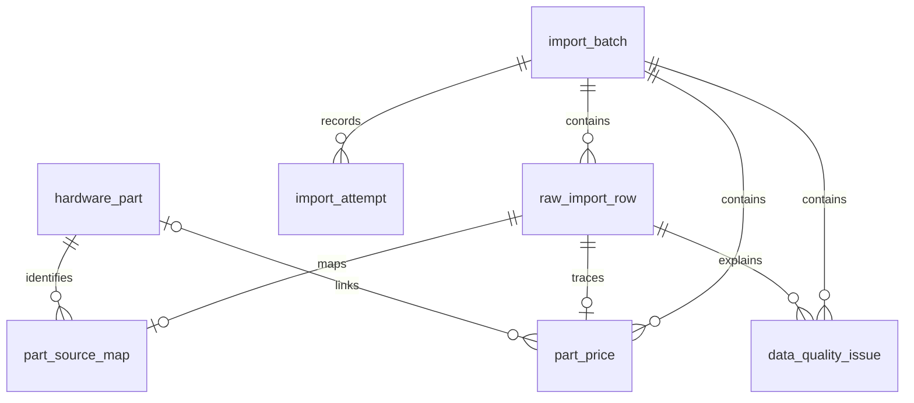

# 03｜数据库表设计（阶段化，而非一次建全）

> 2026-10-13 修订：本章须与 [实施计划修订与业务契约](11_PLAN_REVISION.md) 一起使用；冲突处以修订条款为准。执行顺序与原阶段编号不同，见修订第 8 节。

## 1. 类型与原则
- ID 优先 UUID；`created_at/updated_at` 使用 timestamptz；价格 NUMERIC(12,2)；规格 JSONB，仍为常用筛选字段建立列或生成索引。
- 用户/租户 ID 不能由模型指定，业务资源以 `(tenant_id, owner_user_id)` 双维度检查。
- `dataset_updated_at` 定义为“数据集最后更新日期”，不能等价为单商品 `price_observed_at`。
- `price_quote` 对象必须可回溯数据源；装机条目保存价格快照，保证历史清单价格不会因以后换数据集而改变。

## 2. M01–M03：ETL/公共目录

### `import_batch`
`id`, `source_name`, `source_url`, `dataset_updated_at DATE`, `input_sha256`, `etl_version`, `status`, `started_at`, `finished_at`, `row_count`, `error_count`, `warnings_count`。同一数据集 hash + pipeline version 定义幂等边界。

### `raw_import_row`
`id`, `batch_id`, `source_file`, `line_number`, `row_hash`, `raw_data JSONB`, `normalization_status`, `normalized_part_id NULL`。`UNIQUE(batch_id,source_file,row_number)`；row_number 是逻辑记录序号，line_number/end_line_number 保留物理位置。

### `hardware_part`
`id`, `category`, `display_name`, `normalized_name`, `specifications JSONB`, `is_active`, `quality_status`, `created_at`, `updated_at`。重要：**不对 display_name 设置 UNIQUE**。

### `part_source_map`
`id`, `part_id`, `raw_import_row_id`, `dedupe_rule`, `review_status`。一款规范 SKU 可映射多个原始行，反之存在歧义时需要人工审查。

### `part_price`
`id`, `part_id`, `batch_id`, `price_usd NUMERIC(12,2) NULL`, `currency='USD'`, `price_kind='historical_reference'`, `dataset_updated_at DATE`, `observed_at NULL`, `source_name`, `source_row_id`, `is_quotable`。索引 `(part_id,batch_id)`；未核实不同源行价格冲突不能自动当成一个最终价格。

### `data_quality_issue`
`id`, `batch_id`, `raw_import_row_id`, `severity`, `field_name`, `rule_code`, `message`, `details JSONB`, `resolved_at NULL`。对同条相同规则异常设置合适唯一约束避免重复报警。

## 3. M04：装机业务
### `build`
`id`, `tenant_id`, `owner_user_id`, `name`, `purpose`, `budget_amount NULL`, `budget_currency='USD'`, `version INTEGER DEFAULT 1`, `status` (draft/archived), `created_at`, `updated_at`。

### `build_item`
`id`, `build_id`, `part_id`, `category`, `quantity`, `price_snapshot_usd NULL`, `price_dataset_updated_at`, `price_source_id`, `created_at`。`UNIQUE(build_id,category)` 只对一期每类一件的业务成立；未来内存/风扇多件需求要重新设计。例如按 `slot` / `line_no` 唯一更灵活。

### 装机总价
不建议让总价成为可随意写入的字段；读取时按条目 `Decimal(quantity * price_snapshot_usd)` 计算。任一必选组件无报价时给出“总价不完整”，不可把缺价视 0。

## 4. M05：用户与租户
### `tenant`：`id`, `name`, `status`
### `user_account`：`id`, `email/username UNIQUE`, `password_hash`, `status`, `created_at`
### `tenant_member`：`tenant_id`, `user_id`, `role`, `status`，`UNIQUE(tenant_id,user_id)`。
- 默认用户只访问自己的 build/chat；管理员访问另行显式授权。
- 建议对私有资源查询增加 `(tenant_id,owner_user_id,id)` 相关索引；后续可增 PG RLS 纵深防御。

## 5. M06–M07：聊天与状态
### `chat_session`
`id UUID`, `tenant_id`, `owner_user_id`, `thread_id UNIQUE`, `title`, `status`, `created_at`, `updated_at`。

### `chat_message`
`id`, `session_id`, `role`, `content`（结构化时可 JSONB）, `created_at`, `request_id`, `tool_call_id NULL`。注意 Checkpoint 会存 state，这里的消息表是业务可展示索引，需要避免与 checkpoint 复制导致不一致：明确谁是事实源以及回填策略。

### `agent_execution`
`id`, `session_id`, `tenant_id`, `owner_user_id`, `status`, `request_id`, `error_code NULL`, `started_at`, `finished_at`, `trace_id NULL`。

## 6. M09：RAG
### `knowledge_document`
`id`, `visibility (public/tenant/private)`, `tenant_id NULL`, `owner_user_id NULL`, `title`, `source_uri`, `license_info`, `content_sha256`, `version`, `status`, `created_at`。
### `knowledge_chunk`
`id`, `document_id`, `chunk_index`, `content`, `embedding VECTOR(dimension)`, `metadata JSONB`, `page_ref`, `created_at`。向量维度由选定 embedding model 确认，不硬编码一个推测数值。

## 7. M10：审批、幂等、记忆与审计
### `action_proposal`
`id`, `session_id`, `tenant_id`, `owner_user_id`, `target_build_id`, `expected_build_version`, `proposed_patch JSONB`, `diff JSONB`, `status`, `expires_at`, `approved_by NULL`, `approved_at NULL`, `idempotency_key UNIQUE`。
### `audit_event`
`id`, `actor_user_id`, `tenant_id`, `resource_type`, `resource_id`, `action`, `outcome`, `request_id`, `created_at`, `details_redacted JSONB`。
### `user_memory`（可选）
`id`, `tenant_id`, `user_id`, `namespace`, `key`, `value JSONB`, `source_session_id`, `consent_status`, `created_at`, `updated_at`，可访问和删除。

## 8. 必做的数据库测试
- 两个用户+两个租户：资源归属不能越权查询/更新/删除。
- 相同导入批次重复运行，不产生重复商品/报价。
- 清单一旦建立，后续价格更新不改历史条目快照。
- 版本不一致的写入返回 409，审批并发重复执行只成功一次。
- 原始 ZIP 来源映射能反查所有报价行。

## M02 实际实现与 ER

未审核源行不创建 hardware_part，raw_import_row.normalized_data 保留规范化候选；part_price.part_id 暂为 NULL，is_quotable=false。合法缺价记录仍有一条 NULL 价格记录；ERROR 只留原行和问题，不生成价格记录。M01 的 normalized_data 是原始处理状态，有效目录归属及选价状态应读取 FK 和 part_price 列。

import_batch 用输入 SHA + pipeline_version 唯一标识，并记录全套导出的 artifact_sha256。同一版本的输出内容变动必须升级 pipeline；不同兼容清洗版本可产生新批次及原行/报价处理记录，但已有审核的相同 source_record_key 延续原 part_id。不根据 name/row_hash 自动跨输入版本合并。规格变化需要显式治理，不静默改旧规范实体。

import_attempt 保存每次实际导入/审核尝试、声明的审核者与理由、选价变更（旧/新报价 ID）、状态和 UTC 时间。数据修改在单一事务内提交；异常后回滚，再以独立事务记录 FAILED。已成功批次发生后续审核失败时保留 SUCCEEDED，失败属于具体 attempt。

批次用 PostgreSQL session advisory lock 防止并发重复导入，显式选价用稳定顺序的商品锁与每商品唯一可报价索引。CLI 输入使用 Pydantic 和源字段复核；数据库额外约束 USD、正价、非 NaN、报价所需审核信息及报价原行所属批次。

迁移 m02_001 创建七张表；m02_002 明确拒绝 numeric NaN。按 [PostgreSQL 数值类型文档](https://www.postgresql.org/docs/17/datatype-numeric.html)，NaN 的比较行为需要单独处理，不能只靠大于零检查。金额为 NUMERIC(12,2)，应用仍使用 Decimal。

本轮真实集成测试在随机拥有的 schema 中应用迁移、执行事务并清理，不删除 public 业务表。迁移参考 [Alembic 官方教程](https://alembic.sqlalchemy.org/en/latest/tutorial.html)，事务参考 [SQLAlchemy 官方教程](https://docs.sqlalchemy.org/en/20/tutorial/dbapi_transactions.html)，锁参考 [PostgreSQL 显式锁文档](https://www.postgresql.org/docs/17/explicit-locking.html)。

M01 JSON 内的 import_batch_id 是文件处理指纹；数据库批次使用由输入 SHA/pipeline 确定的 UUID。原 JSON 不重写，数据库归属通过 batch_id 外键表达。
