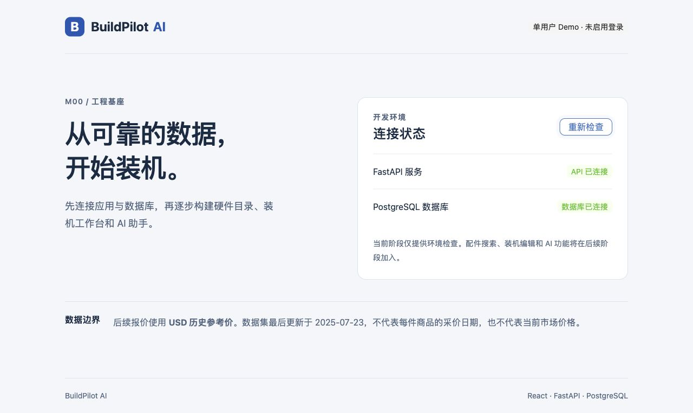

# M00 实施与验收记录

日期：2026-10-13（Asia/Shanghai）。范围：仅工程基座；M01 及以后尚未实施。

## 实现文件

- backend/app/main.py、config.py：应用工厂、Pydantic 响应、存活与真实数据库就绪探测。
- backend/pyproject.toml、uv.lock、.python-version：Python 3.12.12、固定直接依赖及传递依赖锁。
- backend/tests/test_health.py：四项成功/失败路径测试。
- frontend/src/App.tsx、main.tsx、App.css：中文响应式 Demo 状态页、并行请求、取消/超时和重试；Ant Design 组件。
- frontend/vite.config.ts：固定本机开发端口和同源代理。
- frontend/src/tests/、package.json、package-lock.json：四项 UI 测试、类型检查、Oxlint 和构建。
- infra/docker-compose.yml：PostgreSQL 17.6-alpine、镜像摘要、loopback 端口、持久卷、健康检查。
- scripts/setup_env.py、dev.py、smoke.py、Makefile：私有随机凭据、双服务启动/停止、真实 HTTP/数据库检查。
- .github/workflows/ci.yml：基础 CI；当前仅配置，未在 GitHub 远端执行。
- README、架构/API/路线文档、学习笔记：运行、调试、停止与验收说明。

## 实际执行结果

| 检查 | 命令或操作 | 结果 |
|---|---|---|
| 后端 lint/格式 | make check 内 Ruff | 通过 |
| 后端测试 | uv run --locked pytest -q | 4 passed，无弃用警告 |
| 前端 lint/类型 | npm run lint / npm run typecheck | 通过 |
| 前端测试 | npm run test | 4 passed |
| 前端构建 | npm run build | 通过 |
| 数据库启动 | docker compose --env-file .env -f infra/docker-compose.yml up -d --wait | healthy |
| 数据库版本 | 容器内 SELECT version() | PostgreSQL 17.6，aarch64 Linux |
| 真实探测 | python3 scripts/smoke.py | /health=200、/ready=200，真实 SELECT 1 成功 |
| 浏览器 | 打开 5173，点击重新检查 | API/数据库均连接，无 warn/error 控制台日志 |
| 故障恢复 | 停止本项目数据库，重新检查，再启动恢复 | API 继续连接、数据库未就绪提示正常；恢复后重新连接 |
| 原始数据保护 | SHA-256 校验 | 与原基线一致 |

后端单元测试模拟数据库成功/失败；真实数据库连通性由 smoke 和浏览器另行验证。没有运行 ETL 或导入商品。

## 手工验收

1. 从项目根目录 make setup、make db-up、make dev。
2. 打开 http://127.0.0.1:5173/，确认 Demo 标识、历史 USD 说明、两项连接状态。
3. 点击重新检查；打开 8000/health 和 8000/ready 核对 JSON。
4. make db-down 后点击重新检查，确认 API 可用、数据库未就绪；make db-up 后恢复。
5. 在启动终端 Ctrl+C，确认前后端均停止。数据库单独通过 make db-down 停止，持久卷保留。

## 限制及下一阶段

本地开发配置，不是生产部署。没有账号隔离、配件 API、装机编辑、Agent 或 RAG。静态 preview 不提供完整 API 代理。GitHub CI 待推送后验收，未测试生产负载与其他操作系统。未创建提交或发布远端。

下一阶段为 M01 数据审计与文件清洗，须用户另行指定。本轮不推进。
